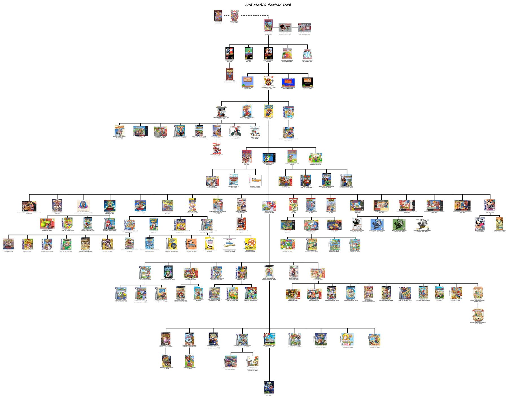

## Today {.smaller}

:::: {.columns}
::: {.column width="55%"}
**Announcements**

- **Homework Two** is due tonight; **PA2** comes out tonight
- **Examlet 4** runs Thursday to Sunday — book your seat on PrairieTest
- Starting this week, labs include office hours

\

**Where we're going**

- Tree vocabulary
- Recursive definitions
- Implementation intro
:::
::: {.column width="45%"}
{width=90%}
:::
::::

## Trees {.smaller}

"… most important nonlinear structure[s] in computer science."
— Donald Knuth, *The Art of Computer Programming*, Vol 1

A tree: \_\_\_\_\_\_\_\_\_\_\_\_\_\_\_\_\_\_\_\_\_\_\_\_\_\_\_\_\_\_

:::: {.columns}
::: {.column width="45%"}
<svg class="nodefig" width="253" height="299">
<g transform="scale(1.15)">
<line x1="30" y1="40" x2="90" y2="110" stroke="#1a1a1a" stroke-width="1.5"/>
<line x1="130" y1="30" x2="90" y2="110" stroke="#1a1a1a" stroke-width="1.5"/>
<line x1="190" y1="85" x2="90" y2="110" stroke="#1a1a1a" stroke-width="1.5"/>
<line x1="90" y1="110" x2="125" y2="195" stroke="#1a1a1a" stroke-width="1.5"/>
<line x1="125" y1="195" x2="25" y2="235" stroke="#1a1a1a" stroke-width="1.5"/>
<circle cx="30" cy="40" r="14" fill="#fff" stroke="#1a1a1a" stroke-width="1.5"/>
<text class="val" x="30" y="46" font-size="16" text-anchor="middle">1</text>
<circle cx="130" cy="30" r="14" fill="#fff" stroke="#1a1a1a" stroke-width="1.5"/>
<text class="val" x="130" y="36" font-size="16" text-anchor="middle">2</text>
<circle cx="190" cy="85" r="14" fill="#fff" stroke="#1a1a1a" stroke-width="1.5"/>
<text class="val" x="190" y="91" font-size="16" text-anchor="middle">3</text>
<circle cx="90" cy="110" r="14" fill="#fff" stroke="#1a1a1a" stroke-width="1.5"/>
<text class="val" x="90" y="116" font-size="16" text-anchor="middle">4</text>
<circle cx="125" cy="195" r="14" fill="#fff" stroke="#1a1a1a" stroke-width="1.5"/>
<text class="val" x="125" y="201" font-size="16" text-anchor="middle">5</text>
<circle cx="25" cy="235" r="14" fill="#fff" stroke="#1a1a1a" stroke-width="1.5"/>
<text class="val" x="25" y="241" font-size="16" text-anchor="middle">6</text>
</g>
</svg>
::: {style="font-size: 0.6em; color: #5a6677;"}
Family trees · organization charts · classification trees (what kind of
flower is this? is this mushroom poisonous?) · file directories ·
non-recursive call graphs
:::
:::
::: {.column width="55%"}
We'll study more specific trees first:
:::
::::

::: notes
The blank: **a connected graph with no cycles.** The picture is a tree with
no root yet — any vertex could be picked as the root and the tree hung from
it.
:::

## Tree terminology {.smaller}

:::: {.columns}
::: {.column width="58%"}
- One of the vertices is called the **root** of the tree. Guess which one it is.
- Make an English word containing the names of the vertices that have a **parent** but no **sibling**.
- How many parents does each vertex have?
- Which vertex has the fewest **children**?
- Which vertex has the most **ancestors**? **descendants**?
- What is d's **depth**? What is d's **height**? What is d's **level**?
- List all the vertices in b's left **subtree**.
- List all the **leaves** in the tree.
:::
::: {.column width="42%"}
<svg class="nodefig" width="384" height="318">
<g transform="scale(1.2)">
<line x1="60" y1="20" x2="110" y2="65" stroke="#1a1a1a" stroke-width="1.5"/>
<line x1="110" y1="65" x2="60" y2="110" stroke="#1a1a1a" stroke-width="1.5"/>
<line x1="110" y1="65" x2="160" y2="110" stroke="#1a1a1a" stroke-width="1.5"/>
<line x1="60" y1="110" x2="15" y2="155" stroke="#1a1a1a" stroke-width="1.5"/>
<line x1="60" y1="110" x2="105" y2="155" stroke="#1a1a1a" stroke-width="1.5"/>
<line x1="160" y1="110" x2="205" y2="155" stroke="#1a1a1a" stroke-width="1.5"/>
<line x1="205" y1="155" x2="250" y2="200" stroke="#1a1a1a" stroke-width="1.5"/>
<line x1="250" y1="200" x2="205" y2="245" stroke="#1a1a1a" stroke-width="1.5"/>
<line x1="250" y1="200" x2="295" y2="245" stroke="#1a1a1a" stroke-width="1.5"/>
<circle cx="60" cy="20" r="14" fill="#fff" stroke="#1a1a1a" stroke-width="1.5"/>
<text class="val" x="60" y="26" font-size="16" text-anchor="middle">a</text>
<circle cx="110" cy="65" r="14" fill="#fff" stroke="#1a1a1a" stroke-width="1.5"/>
<text class="val" x="110" y="71" font-size="16" text-anchor="middle">b</text>
<circle cx="60" cy="110" r="14" fill="#fff" stroke="#1a1a1a" stroke-width="1.5"/>
<text class="val" x="60" y="116" font-size="16" text-anchor="middle">c</text>
<circle cx="160" cy="110" r="14" fill="#fff" stroke="#1a1a1a" stroke-width="1.5"/>
<text class="val" x="160" y="116" font-size="16" text-anchor="middle">d</text>
<circle cx="15" cy="155" r="14" fill="#fff" stroke="#1a1a1a" stroke-width="1.5"/>
<text class="val" x="15" y="161" font-size="16" text-anchor="middle">e</text>
<circle cx="105" cy="155" r="14" fill="#fff" stroke="#1a1a1a" stroke-width="1.5"/>
<text class="val" x="105" y="161" font-size="16" text-anchor="middle">f</text>
<circle cx="205" cy="155" r="14" fill="#fff" stroke="#1a1a1a" stroke-width="1.5"/>
<text class="val" x="205" y="161" font-size="16" text-anchor="middle">g</text>
<circle cx="250" cy="200" r="14" fill="#fff" stroke="#1a1a1a" stroke-width="1.5"/>
<text class="val" x="250" y="206" font-size="16" text-anchor="middle">h</text>
<circle cx="205" cy="245" r="14" fill="#fff" stroke="#1a1a1a" stroke-width="1.5"/>
<text class="val" x="205" y="251" font-size="16" text-anchor="middle">i</text>
<circle cx="295" cy="245" r="14" fill="#fff" stroke="#1a1a1a" stroke-width="1.5"/>
<text class="val" x="295" y="251" font-size="16" text-anchor="middle">j</text>
</g>
</svg>
:::
::::

::: notes
- Root: **a**.
- Parent but no sibling: **b, g, h** — "**bough**" works (and it's a tree
  word).
- Every vertex but the root has exactly **one** parent; the root has none.
- Fewest children: the leaves **e, f, i, j** (zero).
- Most ancestors: **i** and **j** (a, b, d, g, h — five). Most descendants:
  **a** (all nine others).
- d's depth is **2** (edges from the root). d's height is **3** (d–g–h–i).
  d's level is **2** — level is depth, counting the root as level 0. (Some
  books start the root at level 1.)

  **These three are easy to mix up.** Depth is measured *down from the
  root* (how far is d from the top?). Height is measured *up from the
  leaves* (how far is d from its farthest leaf?). A level is a whole *row*:
  every node at the same depth. c and d share a level (both at depth 2), but
  their heights differ: c's is 1, d's is 3.
- b's left subtree: **c, e, f**.
- Leaves: **e, f, i, j**.
:::

## Tree terminology (for your reference) {.smaller}

:::: {.columns}
::: {.column width="62%"}
- **root**: the single node with no parent
- **leaf**: a node with no children
- **child**: a node pointed to by me
- **parent**: the node that points to me
- **sibling**: another child of my parent
- **ancestor**: my parent or my parent's ancestor
- **descendant**: my child or my child's descendant
- **subtree**: a node and its descendants
- **depth** of node x: number of edges on the path from the root to x
- **height** of node x: number of edges on the longest path from x to a leaf
- **level** k: all the nodes at depth k
:::
::: {.column width="38%"}
<svg class="nodefig" width="384" height="318">
<g transform="scale(1.2)">
<line x1="60" y1="20" x2="110" y2="65" stroke="#1a1a1a" stroke-width="1.5"/>
<line x1="110" y1="65" x2="60" y2="110" stroke="#1a1a1a" stroke-width="1.5"/>
<line x1="110" y1="65" x2="160" y2="110" stroke="#1a1a1a" stroke-width="1.5"/>
<line x1="60" y1="110" x2="15" y2="155" stroke="#1a1a1a" stroke-width="1.5"/>
<line x1="60" y1="110" x2="105" y2="155" stroke="#1a1a1a" stroke-width="1.5"/>
<line x1="160" y1="110" x2="205" y2="155" stroke="#1a1a1a" stroke-width="1.5"/>
<line x1="205" y1="155" x2="250" y2="200" stroke="#1a1a1a" stroke-width="1.5"/>
<line x1="250" y1="200" x2="205" y2="245" stroke="#1a1a1a" stroke-width="1.5"/>
<line x1="250" y1="200" x2="295" y2="245" stroke="#1a1a1a" stroke-width="1.5"/>
<circle cx="60" cy="20" r="14" fill="#fff" stroke="#1a1a1a" stroke-width="1.5"/>
<text class="val" x="60" y="26" font-size="16" text-anchor="middle">a</text>
<circle cx="110" cy="65" r="14" fill="#fff" stroke="#1a1a1a" stroke-width="1.5"/>
<text class="val" x="110" y="71" font-size="16" text-anchor="middle">b</text>
<circle cx="60" cy="110" r="14" fill="#fff" stroke="#1a1a1a" stroke-width="1.5"/>
<text class="val" x="60" y="116" font-size="16" text-anchor="middle">c</text>
<circle cx="160" cy="110" r="14" fill="#fff" stroke="#1a1a1a" stroke-width="1.5"/>
<text class="val" x="160" y="116" font-size="16" text-anchor="middle">d</text>
<circle cx="15" cy="155" r="14" fill="#fff" stroke="#1a1a1a" stroke-width="1.5"/>
<text class="val" x="15" y="161" font-size="16" text-anchor="middle">e</text>
<circle cx="105" cy="155" r="14" fill="#fff" stroke="#1a1a1a" stroke-width="1.5"/>
<text class="val" x="105" y="161" font-size="16" text-anchor="middle">f</text>
<circle cx="205" cy="155" r="14" fill="#fff" stroke="#1a1a1a" stroke-width="1.5"/>
<text class="val" x="205" y="161" font-size="16" text-anchor="middle">g</text>
<circle cx="250" cy="200" r="14" fill="#fff" stroke="#1a1a1a" stroke-width="1.5"/>
<text class="val" x="250" y="206" font-size="16" text-anchor="middle">h</text>
<circle cx="205" cy="245" r="14" fill="#fff" stroke="#1a1a1a" stroke-width="1.5"/>
<text class="val" x="205" y="251" font-size="16" text-anchor="middle">i</text>
<circle cx="295" cy="245" r="14" fill="#fff" stroke="#1a1a1a" stroke-width="1.5"/>
<text class="val" x="295" y="251" font-size="16" text-anchor="middle">j</text>
</g>
</svg>
:::
::::

::: notes
Notice that ancestor, descendant and subtree are defined **recursively** —
that's where we're headed.
:::

## Branching: $d$-ary trees (*binary* if $d = 2$) {.smaller}

:::: {.columns}
::: {.column width="38%"}
<svg class="nodefig" width="254" height="254">
<g transform="scale(1.3)">
<line x1="122" y1="20" x2="72" y2="70" stroke="#1a1a1a" stroke-width="1.5"/>
<line x1="122" y1="20" x2="172" y2="70" stroke="#1a1a1a" stroke-width="1.5"/>
<line x1="72" y1="70" x2="27" y2="120" stroke="#1a1a1a" stroke-width="1.5"/>
<line x1="72" y1="70" x2="117" y2="120" stroke="#1a1a1a" stroke-width="1.5"/>
<line x1="117" y1="120" x2="72" y2="170" stroke="#1a1a1a" stroke-width="1.5"/>
<line x1="117" y1="120" x2="162" y2="170" stroke="#1a1a1a" stroke-width="1.5"/>
<circle cx="122" cy="20" r="16" fill="#8ee06a" stroke="#1a1a1a" stroke-width="1.5"/>
<text class="val" x="122" y="26" font-size="18" text-anchor="middle">+</text>
<circle cx="72" cy="70" r="16" fill="#8ee06a" stroke="#1a1a1a" stroke-width="1.5"/>
<text class="val" x="72" y="76" font-size="18" text-anchor="middle">*</text>
<circle cx="172" cy="70" r="16" fill="#ffd166" stroke="#1a1a1a" stroke-width="1.5"/>
<text class="val" x="172" y="76" font-size="18" text-anchor="middle">4</text>
<circle cx="27" cy="120" r="16" fill="#ffd166" stroke="#1a1a1a" stroke-width="1.5"/>
<text class="val" x="27" y="126" font-size="18" text-anchor="middle">2</text>
<circle cx="117" cy="120" r="16" fill="#8ee06a" stroke="#1a1a1a" stroke-width="1.5"/>
<text class="val" x="117" y="126" font-size="18" text-anchor="middle">−</text>
<circle cx="72" cy="170" r="16" fill="#ffd166" stroke="#1a1a1a" stroke-width="1.5"/>
<text class="val" x="72" y="176" font-size="18" text-anchor="middle">3</text>
<circle cx="162" cy="170" r="16" fill="#ffd166" stroke="#1a1a1a" stroke-width="1.5"/>
<text class="val" x="162" y="176" font-size="18" text-anchor="middle">5</text>
</g>
</svg>
:::
::: {.column width="62%"}
A ***d*-ary tree** T is either

- &nbsp;

OR

- &nbsp;
:::
::::

*Full* $d$-ary tree:

\

*Perfect* $d$-ary tree:

\

*Complete* $d$-ary tree:

\

::: notes
A $d$-ary tree is either **empty**, OR **a root node with $d$ subtrees, each
of which is a $d$-ary tree**. Recursive, like the list.

- **Full:** every node has either 0 or $d$ children.
- **Perfect:** every internal node has $d$ children and every leaf is at the
  same depth. Recursively: a perfect tree of height $-1$ is empty; of height
  $h$ is a root whose $d$ subtrees are perfect of height $h-1$.
- **Complete:** perfect down to the second-last level, and the last level is
  filled in from the left.

The picture is the expression $(2 \times (3 - 5)) + 4$. It's full, but not
perfect or complete.
:::

## Binary tree height {.smaller}

height(r) — length of the longest path from root r to a leaf

:::: {.columns}
::: {.column width="38%"}
<svg class="nodefig" width="254" height="254">
<g transform="scale(1.3)">
<line x1="122" y1="20" x2="72" y2="70" stroke="#1a1a1a" stroke-width="1.5"/>
<line x1="122" y1="20" x2="172" y2="70" stroke="#1a1a1a" stroke-width="1.5"/>
<line x1="72" y1="70" x2="27" y2="120" stroke="#1a1a1a" stroke-width="1.5"/>
<line x1="72" y1="70" x2="117" y2="120" stroke="#1a1a1a" stroke-width="1.5"/>
<line x1="117" y1="120" x2="72" y2="170" stroke="#1a1a1a" stroke-width="1.5"/>
<line x1="117" y1="120" x2="162" y2="170" stroke="#1a1a1a" stroke-width="1.5"/>
<circle cx="122" cy="20" r="16" fill="#8ee06a" stroke="#1a1a1a" stroke-width="1.5"/>
<text class="val" x="122" y="26" font-size="18" text-anchor="middle">+</text>
<circle cx="72" cy="70" r="16" fill="#8ee06a" stroke="#1a1a1a" stroke-width="1.5"/>
<text class="val" x="72" y="76" font-size="18" text-anchor="middle">*</text>
<circle cx="172" cy="70" r="16" fill="#ffd166" stroke="#1a1a1a" stroke-width="1.5"/>
<text class="val" x="172" y="76" font-size="18" text-anchor="middle">4</text>
<circle cx="27" cy="120" r="16" fill="#ffd166" stroke="#1a1a1a" stroke-width="1.5"/>
<text class="val" x="27" y="126" font-size="18" text-anchor="middle">2</text>
<circle cx="117" cy="120" r="16" fill="#8ee06a" stroke="#1a1a1a" stroke-width="1.5"/>
<text class="val" x="117" y="126" font-size="18" text-anchor="middle">−</text>
<circle cx="72" cy="170" r="16" fill="#ffd166" stroke="#1a1a1a" stroke-width="1.5"/>
<text class="val" x="72" y="176" font-size="18" text-anchor="middle">3</text>
<circle cx="162" cy="170" r="16" fill="#ffd166" stroke="#1a1a1a" stroke-width="1.5"/>
<text class="val" x="162" y="176" font-size="18" text-anchor="middle">5</text>
</g>
</svg>
:::
::: {.column width="62%"}
Given a binary tree T, write a recursive definition of the height of T,
height(T):
:::
::::

Number of nodes in a perfect tree of height h, N(h):

::: notes
$$\text{height}(T) = \begin{cases} -1 & T \text{ empty} \\
1 + \max(\text{height}(T_L), \text{height}(T_R)) & \text{otherwise} \end{cases}$$

The empty tree has height $-1$, so a single node has height $0$. The
expression tree has height **3**.

$N(-1) = 0$, $N(h) = 2N(h-1) + 1$, so $N(h) = 2^{h+1} - 1$.
:::

## A rooted tree {.smaller}

{width=68%}

::: notes
The Mario family tree — every game descended from the ones before it. A
rooted tree in the wild: one root, every other node has exactly one parent.
:::

## Contemplating implementation {.smaller .smallcode}

:::: {.columns}
::: {.column width="50%"}
<svg class="nodefig" width="412" height="312">
<g transform="scale(1.25)">
<rect x="166" y="4" width="48" height="22" fill="#b6f5cd" stroke="#1a1a1a" stroke-width="1.5"/>
<text class="lbl" x="222" y="20" font-size="14">root</text>
<circle cx="190" cy="15" r="3" fill="#1a1a1a"/>
<line x1="190" y1="15" x2="190" y2="60" stroke="#1a1a1a" stroke-width="1.5"/>
<rect x="166" y="60" width="48" height="22" fill="#fbe0c9" stroke="#1a1a1a" stroke-width="1.5"/>
<text class="val" x="190" y="76" font-size="14" text-anchor="middle">5</text>
<rect x="166" y="82" width="24" height="18" fill="#fbe0c9" stroke="#1a1a1a" stroke-width="1.5"/>
<rect x="190" y="82" width="24" height="18" fill="#fbe0c9" stroke="#1a1a1a" stroke-width="1.5"/>
<rect x="76" y="130" width="48" height="22" fill="#fbe0c9" stroke="#1a1a1a" stroke-width="1.5"/>
<text class="val" x="100" y="146" font-size="14" text-anchor="middle">3</text>
<rect x="76" y="152" width="24" height="18" fill="#fbe0c9" stroke="#1a1a1a" stroke-width="1.5"/>
<rect x="100" y="152" width="24" height="18" fill="#fbe0c9" stroke="#1a1a1a" stroke-width="1.5"/>
<rect x="256" y="130" width="48" height="22" fill="#fbe0c9" stroke="#1a1a1a" stroke-width="1.5"/>
<text class="val" x="280" y="146" font-size="14" text-anchor="middle">9</text>
<rect x="256" y="152" width="24" height="18" fill="#fbe0c9" stroke="#1a1a1a" stroke-width="1.5"/>
<rect x="280" y="152" width="24" height="18" fill="#fbe0c9" stroke="#1a1a1a" stroke-width="1.5"/>
<rect x="31" y="200" width="48" height="22" fill="#fbe0c9" stroke="#1a1a1a" stroke-width="1.5"/>
<text class="val" x="55" y="216" font-size="14" text-anchor="middle">1</text>
<rect x="31" y="222" width="24" height="18" fill="#fbe0c9" stroke="#1a1a1a" stroke-width="1.5"/>
<rect x="55" y="222" width="24" height="18" fill="#fbe0c9" stroke="#1a1a1a" stroke-width="1.5"/>
<rect x="121" y="200" width="48" height="22" fill="#fbe0c9" stroke="#1a1a1a" stroke-width="1.5"/>
<text class="val" x="145" y="216" font-size="14" text-anchor="middle">4</text>
<rect x="121" y="222" width="24" height="18" fill="#fbe0c9" stroke="#1a1a1a" stroke-width="1.5"/>
<rect x="145" y="222" width="24" height="18" fill="#fbe0c9" stroke="#1a1a1a" stroke-width="1.5"/>
<rect x="221" y="200" width="48" height="22" fill="#fbe0c9" stroke="#1a1a1a" stroke-width="1.5"/>
<text class="val" x="245" y="216" font-size="14" text-anchor="middle">6</text>
<rect x="221" y="222" width="24" height="18" fill="#fbe0c9" stroke="#1a1a1a" stroke-width="1.5"/>
<rect x="245" y="222" width="24" height="18" fill="#fbe0c9" stroke="#1a1a1a" stroke-width="1.5"/>
<circle cx="178" cy="91" r="3" fill="#1a1a1a"/>
<line x1="178" y1="91" x2="100" y2="130" stroke="#1a1a1a" stroke-width="1.5"/>
<circle cx="202" cy="91" r="3" fill="#1a1a1a"/>
<line x1="202" y1="91" x2="280" y2="130" stroke="#1a1a1a" stroke-width="1.5"/>
<circle cx="88" cy="161" r="3" fill="#1a1a1a"/>
<line x1="88" y1="161" x2="55" y2="200" stroke="#1a1a1a" stroke-width="1.5"/>
<circle cx="112" cy="161" r="3" fill="#1a1a1a"/>
<line x1="112" y1="161" x2="145" y2="200" stroke="#1a1a1a" stroke-width="1.5"/>
<circle cx="268" cy="161" r="3" fill="#1a1a1a"/>
<line x1="268" y1="161" x2="245" y2="200" stroke="#1a1a1a" stroke-width="1.5"/>
<line x1="282" y1="168" x2="302" y2="154" stroke="#1a1a1a" stroke-width="1.5"/>
<line x1="33" y1="238" x2="53" y2="224" stroke="#1a1a1a" stroke-width="1.5"/>
<line x1="57" y1="238" x2="77" y2="224" stroke="#1a1a1a" stroke-width="1.5"/>
<line x1="123" y1="238" x2="143" y2="224" stroke="#1a1a1a" stroke-width="1.5"/>
<line x1="147" y1="238" x2="167" y2="224" stroke="#1a1a1a" stroke-width="1.5"/>
<line x1="223" y1="238" x2="243" y2="224" stroke="#1a1a1a" stroke-width="1.5"/>
<line x1="247" y1="238" x2="267" y2="224" stroke="#1a1a1a" stroke-width="1.5"/>
</g>
</svg>

**Tree ADT:**

- insert
- remove
- traverse
:::
::: {.column width="50%"}
```cpp
template<class T>
class tree {
public:  // discuss later
private:
    struct Node {
        T data;
        Node * left;
        Node * right;
    };
    Node * root;  // + more?
};
```
:::
::::

::: notes
Each node holds its data and two pointers. Compare the list node: one
`next`, now a `left` and a `right`. The tree itself is just a `root`
pointer — `nullptr` for the empty tree.
:::

## Theorem {.smaller}

**Theorem:** Our implementation of an $n$ item binary tree has \_\_\_\_\_\_\_ null pointers.

<svg class="nodefig" width="412" height="312">
<g transform="scale(1.25)">
<rect x="166" y="4" width="48" height="22" fill="#b6f5cd" stroke="#1a1a1a" stroke-width="1.5"/>
<text class="lbl" x="222" y="20" font-size="14">root</text>
<circle cx="190" cy="15" r="3" fill="#1a1a1a"/>
<line x1="190" y1="15" x2="190" y2="60" stroke="#1a1a1a" stroke-width="1.5"/>
<rect x="166" y="60" width="48" height="22" fill="#fbe0c9" stroke="#1a1a1a" stroke-width="1.5"/>
<text class="val" x="190" y="76" font-size="14" text-anchor="middle">5</text>
<rect x="166" y="82" width="24" height="18" fill="#fbe0c9" stroke="#1a1a1a" stroke-width="1.5"/>
<rect x="190" y="82" width="24" height="18" fill="#fbe0c9" stroke="#1a1a1a" stroke-width="1.5"/>
<rect x="76" y="130" width="48" height="22" fill="#fbe0c9" stroke="#1a1a1a" stroke-width="1.5"/>
<text class="val" x="100" y="146" font-size="14" text-anchor="middle">3</text>
<rect x="76" y="152" width="24" height="18" fill="#fbe0c9" stroke="#1a1a1a" stroke-width="1.5"/>
<rect x="100" y="152" width="24" height="18" fill="#fbe0c9" stroke="#1a1a1a" stroke-width="1.5"/>
<rect x="256" y="130" width="48" height="22" fill="#fbe0c9" stroke="#1a1a1a" stroke-width="1.5"/>
<text class="val" x="280" y="146" font-size="14" text-anchor="middle">9</text>
<rect x="256" y="152" width="24" height="18" fill="#fbe0c9" stroke="#1a1a1a" stroke-width="1.5"/>
<rect x="280" y="152" width="24" height="18" fill="#fbe0c9" stroke="#1a1a1a" stroke-width="1.5"/>
<rect x="31" y="200" width="48" height="22" fill="#fbe0c9" stroke="#1a1a1a" stroke-width="1.5"/>
<text class="val" x="55" y="216" font-size="14" text-anchor="middle">1</text>
<rect x="31" y="222" width="24" height="18" fill="#fbe0c9" stroke="#1a1a1a" stroke-width="1.5"/>
<rect x="55" y="222" width="24" height="18" fill="#fbe0c9" stroke="#1a1a1a" stroke-width="1.5"/>
<rect x="121" y="200" width="48" height="22" fill="#fbe0c9" stroke="#1a1a1a" stroke-width="1.5"/>
<text class="val" x="145" y="216" font-size="14" text-anchor="middle">4</text>
<rect x="121" y="222" width="24" height="18" fill="#fbe0c9" stroke="#1a1a1a" stroke-width="1.5"/>
<rect x="145" y="222" width="24" height="18" fill="#fbe0c9" stroke="#1a1a1a" stroke-width="1.5"/>
<rect x="221" y="200" width="48" height="22" fill="#fbe0c9" stroke="#1a1a1a" stroke-width="1.5"/>
<text class="val" x="245" y="216" font-size="14" text-anchor="middle">6</text>
<rect x="221" y="222" width="24" height="18" fill="#fbe0c9" stroke="#1a1a1a" stroke-width="1.5"/>
<rect x="245" y="222" width="24" height="18" fill="#fbe0c9" stroke="#1a1a1a" stroke-width="1.5"/>
<circle cx="178" cy="91" r="3" fill="#1a1a1a"/>
<line x1="178" y1="91" x2="100" y2="130" stroke="#1a1a1a" stroke-width="1.5"/>
<circle cx="202" cy="91" r="3" fill="#1a1a1a"/>
<line x1="202" y1="91" x2="280" y2="130" stroke="#1a1a1a" stroke-width="1.5"/>
<circle cx="88" cy="161" r="3" fill="#1a1a1a"/>
<line x1="88" y1="161" x2="55" y2="200" stroke="#1a1a1a" stroke-width="1.5"/>
<circle cx="112" cy="161" r="3" fill="#1a1a1a"/>
<line x1="112" y1="161" x2="145" y2="200" stroke="#1a1a1a" stroke-width="1.5"/>
<circle cx="268" cy="161" r="3" fill="#1a1a1a"/>
<line x1="268" y1="161" x2="245" y2="200" stroke="#1a1a1a" stroke-width="1.5"/>
<line x1="282" y1="168" x2="302" y2="154" stroke="#1a1a1a" stroke-width="1.5"/>
<line x1="33" y1="238" x2="53" y2="224" stroke="#1a1a1a" stroke-width="1.5"/>
<line x1="57" y1="238" x2="77" y2="224" stroke="#1a1a1a" stroke-width="1.5"/>
<line x1="123" y1="238" x2="143" y2="224" stroke="#1a1a1a" stroke-width="1.5"/>
<line x1="147" y1="238" x2="167" y2="224" stroke="#1a1a1a" stroke-width="1.5"/>
<line x1="223" y1="238" x2="243" y2="224" stroke="#1a1a1a" stroke-width="1.5"/>
<line x1="247" y1="238" x2="267" y2="224" stroke="#1a1a1a" stroke-width="1.5"/>
</g>
</svg>

::: notes
**$n + 1$.** Count it: the picture has 6 nodes and 7 null pointers.

Proof: there are $2n$ pointer fields in all. Every node except the root has
exactly one pointer aimed at it, so $n - 1$ of them are used. That leaves
$2n - (n - 1) = n + 1$ null.
:::

## Practice 1 {.smaller}

1) Draw a FULL tree with 9 nodes. Is it the same as your neighbour's?

::: notes
Give them a minute with a neighbour. It needn't be the same — there are several full
binary trees with 9 nodes. Every one has **4 internal nodes and 5 leaves**,
though: in a full binary tree, leaves = internal + 1.
:::

## Practice 2 {.smaller}

2) Draw a COMPLETE tree with 12 nodes. Is it the same as your neighbour's?

::: notes
This time it **is** the same as your neighbour's: a complete tree's shape is
fixed by its size. Levels of 1, 2, 4, and then 5 nodes on the bottom level,
filled from the left.
:::

## Practice 3 {.smaller}

3a) Give an *upper bound* for the number of nodes in a tree of height h:

\

\

3b) Give a *lower bound* for the height of a tree containing n nodes:

::: notes
3a) At most a perfect tree: $n \le 2^{h+1} - 1$.

3b) Turn it around: $2^{h+1} \ge n + 1$, so
$h \ge \log_2(n+1) - 1$. A binary tree with $n$ nodes has height
$\Omega(\log n)$ — this will matter for every search tree we build.
:::

## Practice 4 {.smaller}

4) Give upper and lower bounds for the number of nodes in a complete tree of
height h:

::: notes
**Most:** a perfect tree of height $h$, $2^{h+1} - 1$.

**Fewest:** a perfect tree of height $h-1$ plus one node starting the next
level: $(2^h - 1) + 1 = 2^h$.

So $2^h \le n \le 2^{h+1} - 1$, and a complete tree's height is exactly
$\lfloor \log_2 n \rfloor$.
:::
