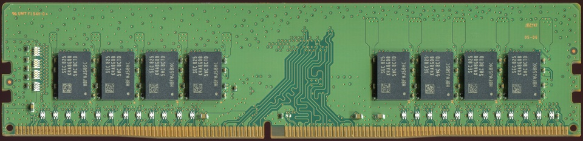

## Today {.smaller}

**Announcements**

- **PA2** is due tonight, 11:59pm
- **Examlet 6** is Thursday to Sunday: binary search trees

\

**Today:**

- How tall is an AVL tree?
- Balanced BSTs: the classics, pros and cons
- B-trees: when the data won't fit in memory

## Recap {.smaller}

Last time: AVL trees, a BST that rotates to stay balanced.

\

| operation | BST, worst case | AVL tree |
|---|:---:|:---:|
| find | $O(n)$ | $O(h)$ |
| insert | $O(n)$ | $O(h)$ |
| remove | $O(n)$ | $O(h)$ |

\

How big can $h$ be, for an AVL tree with $n$ nodes?

::: notes
All three operations walk one path, so all three are $O(h)$ for both trees.
For a plain BST, $h$ can be $n - 1$. Today's question is what $h$ can be
for an AVL tree. Answer, by the end: $O(\log n)$.
:::

## AVL tree analysis {.smaller}

We want: $h = O(\_\_\_\_\_\_\_\_)$.

\

An **upper bound on the height** of a tree with $n$ nodes

is the same as

a **lower bound on the number of nodes** in a tree of height $h$.

\

Define $N(h)$: the least number of nodes in an AVL tree of height $h$.

::: notes
$h = O(\log n)$.

Why the switch: if every AVL tree of height $h$ has at least $N(h)$ nodes,
then a tree with $n$ nodes has $n \ge N(h)$, and turning that around bounds
$h$. Counting nodes in the skinniest possible tree is easier than reasoning
about the tallest possible tree directly.
:::

## Your Turn {.activity}

Draw the AVL tree with the **fewest nodes** for each height.

\

| $h$ | 0 | 1 | 2 | 3 | 4 |
|---|:---:|:---:|:---:|:---:|:---:|
| $N(h)$ | | | | | |

::: notes
Pause here and let them draw. Values: 1, 2, 4, 7, 12.

The skinniest tree of height $h$ has a root, one subtree that is the
skinniest tree of height $h-1$, and the other the skinniest of height
$h-2$: as lopsided as the balance condition allows. Let them find this
from the drawings; it is the next slide.
:::

## A recurrence {.smaller}

$N(h) = 1 + N(\_\_\_\_\_\_) + N(\_\_\_\_\_\_)$

\

Simplify:

\
\
\

Guess a closed form:

::: notes
$N(h) = 1 + N(h-1) + N(h-2)$, with $N(0) = 1$, $N(1) = 2$.

Simplify: $N(h-1) \ge N(h-2)$, so
$N(h) > 2\,N(h-2) > 4\,N(h-4) > 8\,N(h-6) > \cdots$

Every two levels of height at least doubles the node count, so guess
$N(h) \ge 2^{h/2}$. Check against the table: $h = 4$ gives $12 \ge 4$.

(It is a Fibonacci recurrence, so the truth is about $1.618^h$, which is
where the $1.44 \log_2 n$ on a later slide comes from. The proof only
needs the cruder $\sqrt 2^{\,h}$.)
:::

## Prove the guess {.smaller .proof}

**Theorem:** an AVL tree of height $h$ has at least $2^{h/2}$ nodes, for all $h \ge$ \_\_\_\_.

\

Consider an arbitrary AVL tree, and let $h$ denote its height.

Case 1:

Case 2:

Case 3:

::: notes
For all $h \ge 0$.

- **Case 1, $h = 0$:** the tree is one node, and $1 \ge 2^0 = 1$.
- **Case 2, $h = 1$:** the tree has at least 2 nodes, and $2 \ge 2^{1/2} \approx 1.41$.
- **Case 3, $h \ge 2$:** one subtree of the root has height $h-1$, and the
  other has height at least $h-2$ (the balance condition). Both are AVL
  trees, so by an inductive hypothesis that says *every AVL tree of height
  $j < h$ has at least $2^{j/2}$ nodes*, the subtrees have at least
  $2^{(h-1)/2}$ and $2^{(h-2)/2}$ nodes. Since $2^{(h-1)/2} \ge 2^{(h-2)/2}$,
  the tree has at least $1 + 2 \cdot 2^{(h-2)/2} > 2^{h/2}$ nodes.

Two base cases because case 3 reaches back two heights.
:::

## Punchline {.smaller}

$n \ge 2^{h/2}$, so $h \le$ \_\_\_\_\_\_\_\_\_\_\_\_.

\

| operation | BST, worst case | AVL tree |
|---|:---:|:---:|
| find | $O(n)$ | |
| insert | $O(n)$ | |
| remove | $O(n)$ | |

::: notes
Take $\log_2$ of both sides: $h \le 2 \log_2 n$, so $h = O(\log n)$.

All three AVL operations are $O(\log n)$, in the worst case.
:::

## Classic balanced BSTs {.smaller}

**AVL trees:** height at most $1.44 \log_2 n$

\_\_\_\_\_\_ rotations on find

\_\_\_\_\_\_ rotations on insert

\_\_\_\_\_\_ rotations on remove

\

**Red-black trees:** height at most $2 \log_2 n$

A constant number of rotations on insert and on remove

\

And others: 2-3 trees, splay trees, treaps, ...

::: notes
AVL: 0 rotations on find; at most 1 (single or double) on insert, since
the rotation puts the subtree back at its old height; up to $O(\log n)$ on
remove, since a rotation can leave the subtree shorter (lecture 20's
example).

Red-black trees allow more imbalance (height up to $2 \log_2 n$) in
exchange for fewer rotations: at most 2 on insert, at most 3 on remove.
They are what `std::map` uses. We won't cover them; this is the "there are
others" mention.
:::

## Balanced BSTs, pros and cons {.smaller}

**Pros**

- `insert`, `remove`, and `find` are always $O(\log n)$
- An improvement over \_\_\_\_\_\_\_\_\_\_\_\_\_\_
- Range finding and nearest neighbour

\

**Cons**

- It is possible to search for single keys faster
- If the data is too big for memory, it lives on disk, and we need a different structure

::: notes
An improvement over plain BSTs (worst case $O(n)$) and over sorted arrays
or linked lists for a changing set of keys.

Range finding: all keys between $a$ and $b$, in order. Nearest neighbour:
the closest key to a value. A tree does both naturally; a hash table, which
is coming, cannot.

The two cons are the two roads out of here: faster single-key search is
**hashing** (next time), and data on disk is **B-trees** (now).
:::

## Where are we?

```{=html}
<svg class="nodefig" width="560" height="200">
<text x="20" y="108" font-size="30" fill="#1a1a1a">AVL trees</text>
<line x1="170" y1="92" x2="300" y2="52" stroke="#447099" stroke-width="3"/>
<line x1="170" y1="112" x2="300" y2="152" stroke="#447099" stroke-width="3"/>
<text x="315" y="60" font-size="30" fill="#1a1a1a">B-trees</text>
<text x="315" y="162" font-size="30" fill="#1a1a1a">Hash tables</text>
</svg>
```

::: notes
B-trees today, for data on disk. Hash tables next, for faster single-key
search in memory.
:::

## B-trees {.smaller}

The only "out of core" data structure we'll discuss:

a dictionary for **BIG** data.

Can we always fit the data in main memory? So where do we keep it?

```{=html}
<div style="display: flex; align-items: center; justify-content: center; gap: 70px;">


</div>
```

Big-O analysis assumes every basic operation costs about the same.

But...

[Photos: RAM by PantheraLeo1359531, CC BY 4.0; hard drive by Zzubnik, public domain (Wikimedia Commons).]{style="font-size: 0.45em; color: #888;"}

::: notes
Out of core: the data lives in external storage (disk, SSD, or a server
across a network), and only some of it is in memory at any time.

Big-O counts operations as if each costs one unit. Fetching from disk
breaks that assumption badly, as the next slide shows.
:::

## The story on disks {.smaller}

A 2 GHz machine does about 2 million instructions per \_\_\_\_\_\_.

A disk seek takes about \_\_\_\_\_\_\_\_.

\

Imagine an AVL tree storing North American driving records.

How many records?\
How much data, in total?\
How deep is the AVL tree?

\

How many disk seeks to find a record?

::: notes
- 2 million instructions per **millisecond**.
- A hard-disk seek is about **5 ms**, so about 10 million instructions'
  worth of waiting. (An SSD read is closer to 0.1 ms: faster, but still
  about 1000 times slower than memory.)
- Records: about 300 million licensed drivers. At 1 KB each, about 300 GB:
  more than a laptop's memory.
- Depth: between $\log_2 (3 \times 10^8) \approx 28$ and
  $1.44 \times 28 \approx 41$ levels.
- Seeks: one per level if every node is a separate read, so up to about 41
  seeks, about 0.2 seconds for **one** lookup. The instructions to compare
  keys are free by comparison.
:::

## The story on disks, continued {.smaller}

Suppose we weren't careful...

:::: {.columns}
::: {.column width="55%"}
```{=html}
<svg class="nodefig" width="528" height="456" style="display:block; margin:0;">
<g transform="scale(1.2)">
<line x1="210" y1="20" x2="110" y2="80" stroke="#1a1a1a" stroke-width="1.2"/>
<line x1="210" y1="20" x2="310" y2="80" stroke="#1a1a1a" stroke-width="1.2"/>
<line x1="110" y1="80" x2="60" y2="140" stroke="#1a1a1a" stroke-width="1.2"/>
<line x1="110" y1="80" x2="160" y2="140" stroke="#1a1a1a" stroke-width="1.2"/>
<line x1="310" y1="80" x2="260" y2="140" stroke="#1a1a1a" stroke-width="1.2"/>
<line x1="310" y1="80" x2="360" y2="140" stroke="#1a1a1a" stroke-width="1.2"/>
<line x1="60" y1="140" x2="85" y2="200" stroke="#1a1a1a" stroke-width="1.2"/>
<line x1="160" y1="140" x2="185" y2="200" stroke="#1a1a1a" stroke-width="1.2"/>
<line x1="360" y1="140" x2="335" y2="200" stroke="#1a1a1a" stroke-width="1.2"/>
<line x1="360" y1="140" x2="385" y2="200" stroke="#1a1a1a" stroke-width="1.2"/>
<line x1="385" y1="200" x2="400" y2="260" stroke="#1a1a1a" stroke-width="1.2"/>
<circle cx="210" cy="20" r="16" fill="white" stroke="#1a1a1a" stroke-width="1.4"/>
<text x="210" y="25" text-anchor="middle" font-size="15" fill="#1a1a1a">38</text>
<circle cx="110" cy="80" r="16" fill="white" stroke="#1a1a1a" stroke-width="1.4"/>
<text x="110" y="85" text-anchor="middle" font-size="15" fill="#1a1a1a">13</text>
<circle cx="310" cy="80" r="16" fill="white" stroke="#1a1a1a" stroke-width="1.4"/>
<text x="310" y="85" text-anchor="middle" font-size="15" fill="#1a1a1a">51</text>
<circle cx="60" cy="140" r="16" fill="white" stroke="#1a1a1a" stroke-width="1.4"/>
<text x="60" y="145" text-anchor="middle" font-size="15" fill="#1a1a1a">10</text>
<circle cx="160" cy="140" r="16" fill="white" stroke="#1a1a1a" stroke-width="1.4"/>
<text x="160" y="145" text-anchor="middle" font-size="15" fill="#1a1a1a">25</text>
<circle cx="260" cy="140" r="16" fill="white" stroke="#1a1a1a" stroke-width="1.4"/>
<text x="260" y="145" text-anchor="middle" font-size="15" fill="#1a1a1a">40</text>
<circle cx="360" cy="140" r="16" fill="white" stroke="#1a1a1a" stroke-width="1.4"/>
<text x="360" y="145" text-anchor="middle" font-size="15" fill="#1a1a1a">84</text>
<circle cx="85" cy="200" r="16" fill="white" stroke="#1a1a1a" stroke-width="1.4"/>
<text x="85" y="205" text-anchor="middle" font-size="15" fill="#1a1a1a">12</text>
<circle cx="185" cy="200" r="16" fill="white" stroke="#1a1a1a" stroke-width="1.4"/>
<text x="185" y="205" text-anchor="middle" font-size="15" fill="#1a1a1a">37</text>
<circle cx="335" cy="200" r="16" fill="white" stroke="#1a1a1a" stroke-width="1.4"/>
<text x="335" y="205" text-anchor="middle" font-size="15" fill="#1a1a1a">66</text>
<circle cx="385" cy="200" r="16" fill="white" stroke="#1a1a1a" stroke-width="1.4"/>
<text x="385" y="205" text-anchor="middle" font-size="15" fill="#1a1a1a">89</text>
<circle cx="400" cy="260" r="16" fill="white" stroke="#1a1a1a" stroke-width="1.4"/>
<text x="400" y="265" text-anchor="middle" font-size="15" fill="#1a1a1a">95</text>
<ellipse cx="230" cy="335" rx="190" ry="38" fill="#c6e6ea" stroke="#1a1a1a" stroke-width="1.2"/>
<ellipse cx="230" cy="335" rx="14" ry="4" fill="white" stroke="#1a1a1a" stroke-width="1"/>
</g>
</svg>
```
:::
::: {.column width="45%"}
\

Following one pointer costs one disk read.

\

So the number of disk reads is

\_\_\_\_\_\_\_\_\_\_\_\_.
:::
::::

::: notes
Every node of the tree is somewhere else on the disk, so each step down
the tree is another read. The number of reads is the height of the tree.
To make lookups fast, make the tree as **shallow** as possible.
Comparisons inside a node are cheap; it's moving between nodes that costs.
:::

## B-tree of order $m$ {.smaller}

```{=html}
<svg class="nodefig" width="950" height="150" style="display:block; margin:0;">
<rect x="2" y="2" width="60" height="54" fill="#b8f7f7" stroke="#1a1a1a" stroke-width="1.2"/>
<text x="32.0" y="37" text-anchor="middle" font-size="24" fill="#1a1a1a">12</text>
<rect x="62" y="2" width="60" height="54" fill="#b8f7f7" stroke="#1a1a1a" stroke-width="1.2"/>
<text x="92.0" y="37" text-anchor="middle" font-size="24" fill="#1a1a1a">18</text>
<rect x="122" y="2" width="60" height="54" fill="#b8f7f7" stroke="#1a1a1a" stroke-width="1.2"/>
<text x="152.0" y="37" text-anchor="middle" font-size="24" fill="#1a1a1a">27</text>
<rect x="182" y="2" width="60" height="54" fill="#b8f7f7" stroke="#1a1a1a" stroke-width="1.2"/>
<text x="212.0" y="37" text-anchor="middle" font-size="24" fill="#1a1a1a">52</text>
<rect x="242" y="2" width="60" height="54" fill="#b8f7f7" stroke="#1a1a1a" stroke-width="1.2"/>
<text x="272.0" y="37" text-anchor="middle" font-size="24" fill="#1a1a1a">58</text>
<rect x="302" y="2" width="60" height="54" fill="#b8f7f7" stroke="#1a1a1a" stroke-width="1.2"/>
<text x="332.0" y="37" text-anchor="middle" font-size="24" fill="#1a1a1a">63</text>
<rect x="362" y="2" width="60" height="54" fill="#b8f7f7" stroke="#1a1a1a" stroke-width="1.2"/>
<text x="392.0" y="37" text-anchor="middle" font-size="24" fill="#1a1a1a">77</text>
<rect x="422" y="2" width="60" height="54" fill="#b8f7f7" stroke="#1a1a1a" stroke-width="1.2"/>
<text x="452.0" y="37" text-anchor="middle" font-size="24" fill="#1a1a1a">89</text>
<rect x="2" y="2" width="480" height="54" fill="none" stroke="#1a1a1a" stroke-width="3"/>
<ellipse cx="800" cy="110" rx="140" ry="30" fill="#c6e6ea" stroke="#1a1a1a" stroke-width="1.2"/>
<ellipse cx="800" cy="110" rx="14" ry="4" fill="white" stroke="#1a1a1a" stroke-width="1"/>
</svg>
```

**Goal:** minimize the number of reads from disk.

- Build a tree that uses one disk block per node
  - A disk block is the fundamental unit of transfer
- Nodes have more than one key
- The tree should be balanced and **shallow**
  - In practice, branching factors over 1000 are common

::: notes
If one read brings in a whole block anyway, fill the block: a node holds as
many keys as fit. More keys per node means more children per node, which
means a shallower tree, which means fewer reads.

Live demo on the next slide, before the node picture and the definition.
:::

## A B-tree {.smaller}

```{=html}
<iframe src="viz/btree_explorer.html?order=5&keys=630,520,500,690,940,400,710,250,590,350,330,390,790,870,110,820,80,410,160,990" width="100%" height="540" style="border: none; border-radius: 8px;"></iframe>
```

::: notes
Before the definition: **what do you notice?** Let them find it.

- Every leaf is on the same level.
- The keys in a node are in order.
- A node with $i$ keys has $i + 1$ children.
- Search-tree order: the keys between 160 and 350 (250, 330) are in the
  child between them.
- Nodes hold different numbers of keys, 2 to 4 here, but the root holds
  just 1. (Nobody ever has 5, or 1 outside the root: foreshadows the order.)

Then insert. Step mode is on: **Step** advances. Keys are multiples of 10,
so there's room in between. 395 just fills the 390 400 410 leaf; 900
into the full 820 870 940 990 leaf splits it, and the circled middle key
rises into the parent. Keep inserting into one area until
the root splits: the tree grows at the **top**, so the leaves stay level.
Delete works too (borrow from a sibling, or merge). Our own copy of Gnarley
Trees (Kubo Kovac), on a fixed stage that doesn't reflow.
:::

## B-tree of order $m$: a node {.smaller}

```{=html}
<svg class="nodefig" width="564" height="108">
<defs><marker id="arr" markerWidth="8" markerHeight="8" refX="4" refY="4" orient="auto"><path d="M0,0 L8,4 L0,8 z" fill="#1a1a1a"/></marker></defs>
<g transform="translate(6,0) scale(1.5)">
<rect x="0" y="0" width="46" height="36" fill="#f3b48a" stroke="#1a1a1a" stroke-width="1.5"/>
<text x="23.0" y="24" text-anchor="middle" font-size="18" fill="#1a1a1a">k<tspan dy='5' font-size='11'>1</tspan></text>
<rect x="46" y="0" width="46" height="36" fill="#f3b48a" stroke="#1a1a1a" stroke-width="1.5"/>
<text x="69.0" y="24" text-anchor="middle" font-size="18" fill="#1a1a1a">k<tspan dy='5' font-size='11'>2</tspan></text>
<rect x="92" y="0" width="46" height="36" fill="#f3b48a" stroke="#1a1a1a" stroke-width="1.5"/>
<text x="115.0" y="24" text-anchor="middle" font-size="18" fill="#1a1a1a">…</text>
<rect x="138" y="0" width="46" height="36" fill="#f3b48a" stroke="#1a1a1a" stroke-width="1.5"/>
<text x="161.0" y="24" text-anchor="middle" font-size="18" fill="#1a1a1a">k<tspan dy='5' font-size='11'>i</tspan></text>
<rect x="184" y="0" width="46" height="36" fill="white" stroke="#1a1a1a" stroke-width="1.5"/>
<rect x="230" y="0" width="46" height="36" fill="white" stroke="#1a1a1a" stroke-width="1.5"/>
<rect x="276" y="0" width="46" height="36" fill="white" stroke="#1a1a1a" stroke-width="1.5"/>
<rect x="322" y="0" width="46" height="36" fill="white" stroke="#1a1a1a" stroke-width="1.5"/>
<line x1="0" y1="36" x2="0" y2="66" stroke="#1a1a1a" stroke-width="1.5" marker-end="url(#arr)"/>
<line x1="46" y1="36" x2="46" y2="66" stroke="#1a1a1a" stroke-width="1.5" marker-end="url(#arr)"/>
<line x1="92" y1="36" x2="92" y2="66" stroke="#1a1a1a" stroke-width="1.5" marker-end="url(#arr)"/>
<line x1="138" y1="36" x2="138" y2="66" stroke="#1a1a1a" stroke-width="1.5" marker-end="url(#arr)"/>
<line x1="184" y1="36" x2="184" y2="66" stroke="#1a1a1a" stroke-width="1.5" marker-end="url(#arr)"/>
</g>
</svg>
```

Every node has room for $m - 1$ keys, but \_\_\_\_\_\_\_\_\_\_\_\_\_\_\_\_\_\_.

If a node has $i$ keys, then it has \_\_\_\_\_\_\_\_ child pointers.

The keys in a node are in order.

::: notes
- ...but it isn't always full: a node may have fewer keys (down to a
  minimum, on the next slide).
- $i$ keys, $i + 1$ child pointers (for an internal node). Child $j$ holds
  the keys between key $j$ and key $j + 1$: the BST rule, generalized.

The key slots are an array, so a node can be searched by binary search.
:::

## Definition of a B-tree {.smaller}

A B-tree of **order $m$** is an $m$-way search tree in which:

- Every node holds at most $m - 1$ keys, in order
- An internal node with $i$ keys has $i + 1$ children
- Every non-root node holds at least $\lceil m/2 \rceil - 1$ keys
- The root holds at least 1 key
- All leaves are on the same level

```{=html}
<svg class="nodefig" width="653" height="222">
<g transform="scale(1.1)">
<line x1="103.0" y1="110" x2="36.0" y2="170" stroke="#1a1a1a" stroke-width="1.2"/>
<rect x="2" y="170" width="34" height="30" fill="white" stroke="#1a1a1a" stroke-width="1.5"/>
<text x="19.0" y="190" text-anchor="middle" font-size="16" fill="#1a1a1a">1</text>
<rect x="36" y="170" width="34" height="30" fill="white" stroke="#1a1a1a" stroke-width="1.5"/>
<text x="53.0" y="190" text-anchor="middle" font-size="16" fill="#1a1a1a">2</text>
<line x1="137.0" y1="110" x2="120.0" y2="170" stroke="#1a1a1a" stroke-width="1.2"/>
<rect x="86" y="170" width="34" height="30" fill="white" stroke="#1a1a1a" stroke-width="1.5"/>
<text x="103.0" y="190" text-anchor="middle" font-size="16" fill="#1a1a1a">6</text>
<rect x="120" y="170" width="34" height="30" fill="white" stroke="#1a1a1a" stroke-width="1.5"/>
<text x="137.0" y="190" text-anchor="middle" font-size="16" fill="#1a1a1a">7</text>
<line x1="171.0" y1="110" x2="221.0" y2="170" stroke="#1a1a1a" stroke-width="1.2"/>
<rect x="170" y="170" width="34" height="30" fill="white" stroke="#1a1a1a" stroke-width="1.5"/>
<text x="187.0" y="190" text-anchor="middle" font-size="16" fill="#1a1a1a">12</text>
<rect x="204" y="170" width="34" height="30" fill="white" stroke="#1a1a1a" stroke-width="1.5"/>
<text x="221.0" y="190" text-anchor="middle" font-size="16" fill="#1a1a1a">14</text>
<rect x="238" y="170" width="34" height="30" fill="white" stroke="#1a1a1a" stroke-width="1.5"/>
<text x="255.0" y="190" text-anchor="middle" font-size="16" fill="#1a1a1a">16</text>
<rect x="103.0" y="80" width="34" height="30" fill="white" stroke="#1a1a1a" stroke-width="1.5"/>
<text x="120.0" y="100" text-anchor="middle" font-size="16" fill="#1a1a1a">3</text>
<rect x="137.0" y="80" width="34" height="30" fill="white" stroke="#1a1a1a" stroke-width="1.5"/>
<text x="154.0" y="100" text-anchor="middle" font-size="16" fill="#1a1a1a">8</text>
<line x1="406.0" y1="110" x2="322.0" y2="170" stroke="#1a1a1a" stroke-width="1.2"/>
<rect x="288" y="170" width="34" height="30" fill="white" stroke="#1a1a1a" stroke-width="1.5"/>
<text x="305.0" y="190" text-anchor="middle" font-size="16" fill="#1a1a1a">25</text>
<rect x="322" y="170" width="34" height="30" fill="white" stroke="#1a1a1a" stroke-width="1.5"/>
<text x="339.0" y="190" text-anchor="middle" font-size="16" fill="#1a1a1a">26</text>
<line x1="440.0" y1="110" x2="406.0" y2="170" stroke="#1a1a1a" stroke-width="1.2"/>
<rect x="372" y="170" width="34" height="30" fill="white" stroke="#1a1a1a" stroke-width="1.5"/>
<text x="389.0" y="190" text-anchor="middle" font-size="16" fill="#1a1a1a">29</text>
<rect x="406" y="170" width="34" height="30" fill="white" stroke="#1a1a1a" stroke-width="1.5"/>
<text x="423.0" y="190" text-anchor="middle" font-size="16" fill="#1a1a1a">45</text>
<line x1="474.0" y1="110" x2="524.0" y2="170" stroke="#1a1a1a" stroke-width="1.2"/>
<rect x="456" y="170" width="34" height="30" fill="white" stroke="#1a1a1a" stroke-width="1.5"/>
<text x="473.0" y="190" text-anchor="middle" font-size="16" fill="#1a1a1a">52</text>
<rect x="490" y="170" width="34" height="30" fill="white" stroke="#1a1a1a" stroke-width="1.5"/>
<text x="507.0" y="190" text-anchor="middle" font-size="16" fill="#1a1a1a">53</text>
<rect x="524" y="170" width="34" height="30" fill="white" stroke="#1a1a1a" stroke-width="1.5"/>
<text x="541.0" y="190" text-anchor="middle" font-size="16" fill="#1a1a1a">55</text>
<rect x="558" y="170" width="34" height="30" fill="white" stroke="#1a1a1a" stroke-width="1.5"/>
<text x="575.0" y="190" text-anchor="middle" font-size="16" fill="#1a1a1a">68</text>
<rect x="406.0" y="80" width="34" height="30" fill="white" stroke="#1a1a1a" stroke-width="1.5"/>
<text x="423.0" y="100" text-anchor="middle" font-size="16" fill="#1a1a1a">28</text>
<rect x="440.0" y="80" width="34" height="30" fill="white" stroke="#1a1a1a" stroke-width="1.5"/>
<text x="457.0" y="100" text-anchor="middle" font-size="16" fill="#1a1a1a">48</text>
<line x1="271.5" y1="30" x2="137.0" y2="80" stroke="#1a1a1a" stroke-width="1.2"/>
<line x1="305.5" y1="30" x2="440.0" y2="80" stroke="#1a1a1a" stroke-width="1.2"/>
<rect x="271.5" y="0" width="34" height="30" fill="white" stroke="#1a1a1a" stroke-width="1.5"/>
<text x="288.5" y="20" text-anchor="middle" font-size="16" fill="#1a1a1a">17</text>
</g>
</svg>
```

::: notes
Ask: **what is the order of this tree?**

- At most 4 keys in a node (52 53 55 68), so $m - 1 \ge 4$: $m \ge 5$.
- Non-root nodes with only 2 keys, so $\lceil m/2 \rceil - 1 \le 2$: $m \le 6$.
- So **5 or 6**. Both satisfy the definition. But if it were order 6, the
  root could have held 3 8 17 28 48 in one node; it only splits into
  2 + 1 + 2 at order 5 (insertion isn't covered this term, so this part is
  a teaser).

Check it against the rules with them: each internal node has one more child
than keys; every leaf is at depth 2; the keys between 8 and 17 (12, 14, 16)
are in the child between 8 and 17.

The minimum keeps the tree from going thin, which is what keeps it
shallow: every non-root node has at least $\lceil m/2 \rceil$ children, so
the height is $O(\log_m n)$. Because all leaves are on the same level, the
tree is perfectly balanced by definition, no rotations involved.
:::

## Your Turn {.activity .smaller}

Place the keys into this B-tree of order 5. Not every slot will be used.

15&ensp;22&ensp;31&ensp;38&ensp;44&ensp;50&ensp;57&ensp;63&ensp;71&ensp;79&ensp;86&ensp;94

```{=html}
<svg class="nodefig" width="722" height="125">
<g transform="scale(0.95)">
<line x1="312.0" y1="30" x2="84.0" y2="100" stroke="#1a1a1a" stroke-width="1.2"/>
<rect x="16.0" y="100" width="34" height="30" fill="white" stroke="#1a1a1a" stroke-width="1.5"/>
<rect x="50.0" y="100" width="34" height="30" fill="white" stroke="#1a1a1a" stroke-width="1.5"/>
<rect x="84.0" y="100" width="34" height="30" fill="white" stroke="#1a1a1a" stroke-width="1.5"/>
<rect x="118.0" y="100" width="34" height="30" fill="white" stroke="#1a1a1a" stroke-width="1.5"/>
<line x1="346.0" y1="30" x2="232.0" y2="100" stroke="#1a1a1a" stroke-width="1.2"/>
<rect x="164.0" y="100" width="34" height="30" fill="white" stroke="#1a1a1a" stroke-width="1.5"/>
<rect x="198.0" y="100" width="34" height="30" fill="white" stroke="#1a1a1a" stroke-width="1.5"/>
<rect x="232.0" y="100" width="34" height="30" fill="white" stroke="#1a1a1a" stroke-width="1.5"/>
<rect x="266.0" y="100" width="34" height="30" fill="white" stroke="#1a1a1a" stroke-width="1.5"/>
<line x1="380.0" y1="30" x2="380.0" y2="100" stroke="#1a1a1a" stroke-width="1.2"/>
<rect x="312.0" y="100" width="34" height="30" fill="white" stroke="#1a1a1a" stroke-width="1.5"/>
<rect x="346.0" y="100" width="34" height="30" fill="white" stroke="#1a1a1a" stroke-width="1.5"/>
<rect x="380.0" y="100" width="34" height="30" fill="white" stroke="#1a1a1a" stroke-width="1.5"/>
<rect x="414.0" y="100" width="34" height="30" fill="white" stroke="#1a1a1a" stroke-width="1.5"/>
<line x1="414.0" y1="30" x2="528.0" y2="100" stroke="#1a1a1a" stroke-width="1.2"/>
<rect x="460.0" y="100" width="34" height="30" fill="white" stroke="#1a1a1a" stroke-width="1.5"/>
<rect x="494.0" y="100" width="34" height="30" fill="white" stroke="#1a1a1a" stroke-width="1.5"/>
<rect x="528.0" y="100" width="34" height="30" fill="white" stroke="#1a1a1a" stroke-width="1.5"/>
<rect x="562.0" y="100" width="34" height="30" fill="white" stroke="#1a1a1a" stroke-width="1.5"/>
<line x1="448.0" y1="30" x2="676.0" y2="100" stroke="#1a1a1a" stroke-width="1.2"/>
<rect x="608.0" y="100" width="34" height="30" fill="white" stroke="#1a1a1a" stroke-width="1.5"/>
<rect x="642.0" y="100" width="34" height="30" fill="white" stroke="#1a1a1a" stroke-width="1.5"/>
<rect x="676.0" y="100" width="34" height="30" fill="white" stroke="#1a1a1a" stroke-width="1.5"/>
<rect x="710.0" y="100" width="34" height="30" fill="white" stroke="#1a1a1a" stroke-width="1.5"/>
<rect x="312.0" y="0" width="34" height="30" fill="white" stroke="#1a1a1a" stroke-width="1.5"/>
<rect x="346.0" y="0" width="34" height="30" fill="white" stroke="#1a1a1a" stroke-width="1.5"/>
<rect x="380.0" y="0" width="34" height="30" fill="white" stroke="#1a1a1a" stroke-width="1.5"/>
<rect x="414.0" y="0" width="34" height="30" fill="white" stroke="#1a1a1a" stroke-width="1.5"/>
</g>
</svg>
```

::: notes
This is the shape of Examlet 7's btree_build question.

One answer: root 31, 57, 79; leaves 15 22 | 38 44 50 | 63 71 | 86 94.

There are others: the root can hold 2 keys (3 leaves) or 3 keys (4 leaves).
A root with 1 key would need 11 keys in 2 leaves (at most 8), and 4 root
keys would leave 8 keys for 5 leaves (at least 10). Every leaf must hold 2
to 4 keys.
:::

## Back to the driving records {.smaller}

How many keys can a B-tree of order $m$ and height $h$ hold?

\

With $m = 1000$: how tall is the tree for 300 million records?

\

How many disk reads to find a record?

::: notes
At most $m - 1$ keys per node, and at most $m^d$ nodes at depth $d$, so at
most $m^{h+1} - 1$ keys in all.

With $m = 1000$: height 2 holds up to $10^9 - 1$ keys, plenty for
$3 \times 10^8$. So 3 reads, against about 41 for the AVL tree, and in
practice the root stays in memory, so 2.
:::

## Next time {.smaller}

**Hashing:** search for a single key faster than $O(\log n)$.

\

| structure | find |
|---|:---:|
| AVL tree | $O(\log n)$ |
| B-tree (disk reads) | $O(\log_m n)$ |
| hash table | ? |
