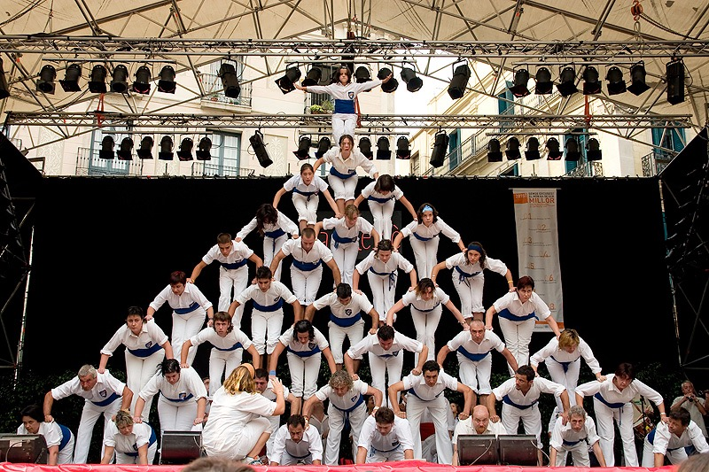

## {.smaller}



[This image reminds us of a ________________, which is one way we can implement ADT\
______________________, whose functions include ______________ and ________________,\
with running times ______________________.]{style="display:block; line-height:1.9; margin-top:0.4em;"}

::: notes
(2024's opening slide, kept as it was.) Monday only got as far as defining
a heap, so this is the recap, filled in aloud: **heap**, **priority
queue**, **insert** and **removeMin**, $O(\log n)$ each.
:::

## Today {.smaller}

**Announcements**

- **Examlet 7** is this week: AVL trees and B-trees (no hashing)
- **PA3** is due Monday 11/23
- **Lab Hash** is due Sunday 11/22

\

**Today:**

- Heaps: insert and removeMin, continued
- Building a heap all at once
- heapSort

## Heap Explorer

```{=html}
<iframe src="viz/heap_explorer.html" width="100%" height="580" style="border: none; border-radius: 8px;"></iframe>
```

::: notes
Live demo (copied from DSCI 221's heaps lesson). Random Heap, or insert a
few values the room calls out, asking before each click where it will
land. Then Remove Min a few times. The array under the tree updates with
it; the root is at index 1, as on the slides. Speed slider bottom right.
:::

## Code: {.smaller .midcode}

```cpp
void heap<T>::insert(const T & key) {
    if (size == capacity) growArray();
    size++;
    items[size] = key;
    heapifyUp(size);
}
```

```cpp
void heap<T>::heapifyUp(int cIndex) {
    if (cIndex > _____)
        if (items[cIndex] ___ items[parent(cIndex)]) {
            swap(__________, __________);
            heapifyUp(__________);
        }
}
```

::: notes
- `cIndex > 1`: stop at the root
- `items[cIndex] < items[parent(cIndex)]`
- `swap(items[cIndex], items[parent(cIndex)])`
- `heapifyUp(parent(cIndex))`
:::

## (min)Heap: removeMin {.smaller}

```{=html}
<svg class="nodefig" width="1120" height="512" viewBox="0 0 800 366" style="display:block; margin:0 auto;">
<line x1="400.0" y1="26" x2="240.0" y2="112" stroke="#1a1a1a" stroke-width="2.4"/>
<line x1="400.0" y1="26" x2="560.0" y2="112" stroke="#1a1a1a" stroke-width="2.4"/>
<line x1="240.0" y1="112" x2="160.0" y2="198" stroke="#1a1a1a" stroke-width="2.4"/>
<line x1="240.0" y1="112" x2="320.0" y2="198" stroke="#1a1a1a" stroke-width="2.4"/>
<line x1="560.0" y1="112" x2="480.0" y2="198" stroke="#1a1a1a" stroke-width="2.4"/>
<line x1="560.0" y1="112" x2="640.0" y2="198" stroke="#1a1a1a" stroke-width="2.4"/>
<line x1="160.0" y1="198" x2="120.0" y2="284" stroke="#1a1a1a" stroke-width="2.4"/>
<line x1="160.0" y1="198" x2="200.0" y2="284" stroke="#1a1a1a" stroke-width="2.4"/>
<line x1="320.0" y1="198" x2="280.0" y2="284" stroke="#1a1a1a" stroke-width="2.4"/>
<line x1="320.0" y1="198" x2="360.0" y2="284" stroke="#1a1a1a" stroke-width="2.4"/>
<line x1="480.0" y1="198" x2="440.0" y2="284" stroke="#1a1a1a" stroke-width="2.4"/>
<circle cx="400.0" cy="26" r="20" fill="#3ddc3d"/>
<text x="400.0" y="32.1" text-anchor="middle" font-size="17" fill="#1a1a1a">4</text>
<circle cx="240.0" cy="112" r="20" fill="#f7e600"/>
<text x="240.0" y="118.1" text-anchor="middle" font-size="17" fill="#1a1a1a">5</text>
<circle cx="560.0" cy="112" r="20" fill="#f7e600"/>
<text x="560.0" y="118.1" text-anchor="middle" font-size="17" fill="#1a1a1a">6</text>
<circle cx="160.0" cy="198" r="20" fill="#ffa726"/>
<text x="160.0" y="204.1" text-anchor="middle" font-size="17" fill="#1a1a1a">15</text>
<circle cx="320.0" cy="198" r="20" fill="#ffa726"/>
<text x="320.0" y="204.1" text-anchor="middle" font-size="17" fill="#1a1a1a">9</text>
<circle cx="480.0" cy="198" r="20" fill="#ffa726"/>
<text x="480.0" y="204.1" text-anchor="middle" font-size="17" fill="#1a1a1a">7</text>
<circle cx="640.0" cy="198" r="20" fill="#ffa726"/>
<text x="640.0" y="204.1" text-anchor="middle" font-size="17" fill="#1a1a1a">20</text>
<circle cx="120.0" cy="284" r="20" fill="#ff4b2b"/>
<text x="120.0" y="290.1" text-anchor="middle" font-size="17" fill="#1a1a1a">16</text>
<circle cx="200.0" cy="284" r="20" fill="#ff4b2b"/>
<text x="200.0" y="290.1" text-anchor="middle" font-size="17" fill="#1a1a1a">25</text>
<circle cx="280.0" cy="284" r="20" fill="#ff4b2b"/>
<text x="280.0" y="290.1" text-anchor="middle" font-size="17" fill="#1a1a1a">14</text>
<circle cx="360.0" cy="284" r="20" fill="#ff4b2b"/>
<text x="360.0" y="290.1" text-anchor="middle" font-size="17" fill="#1a1a1a">12</text>
<circle cx="440.0" cy="284" r="20" fill="#ff4b2b"/>
<text x="440.0" y="290.1" text-anchor="middle" font-size="17" fill="#1a1a1a">11</text>
<rect x="100.0" y="318" width="50" height="44" fill="#3ddc3d" stroke="#1a1a1a" stroke-width="1.5"/>
<text x="125.0" y="346.8" text-anchor="middle" font-size="19" fill="#1a1a1a">4</text>
<rect x="150.0" y="318" width="50" height="44" fill="#f7e600" stroke="#1a1a1a" stroke-width="1.5"/>
<text x="175.0" y="346.8" text-anchor="middle" font-size="19" fill="#1a1a1a">5</text>
<rect x="200.0" y="318" width="50" height="44" fill="#f7e600" stroke="#1a1a1a" stroke-width="1.5"/>
<text x="225.0" y="346.8" text-anchor="middle" font-size="19" fill="#1a1a1a">6</text>
<rect x="250.0" y="318" width="50" height="44" fill="#ffa726" stroke="#1a1a1a" stroke-width="1.5"/>
<text x="275.0" y="346.8" text-anchor="middle" font-size="19" fill="#1a1a1a">15</text>
<rect x="300.0" y="318" width="50" height="44" fill="#ffa726" stroke="#1a1a1a" stroke-width="1.5"/>
<text x="325.0" y="346.8" text-anchor="middle" font-size="19" fill="#1a1a1a">9</text>
<rect x="350.0" y="318" width="50" height="44" fill="#ffa726" stroke="#1a1a1a" stroke-width="1.5"/>
<text x="375.0" y="346.8" text-anchor="middle" font-size="19" fill="#1a1a1a">7</text>
<rect x="400.0" y="318" width="50" height="44" fill="#ffa726" stroke="#1a1a1a" stroke-width="1.5"/>
<text x="425.0" y="346.8" text-anchor="middle" font-size="19" fill="#1a1a1a">20</text>
<rect x="450.0" y="318" width="50" height="44" fill="#ff4b2b" stroke="#1a1a1a" stroke-width="1.5"/>
<text x="475.0" y="346.8" text-anchor="middle" font-size="19" fill="#1a1a1a">16</text>
<rect x="500.0" y="318" width="50" height="44" fill="#ff4b2b" stroke="#1a1a1a" stroke-width="1.5"/>
<text x="525.0" y="346.8" text-anchor="middle" font-size="19" fill="#1a1a1a">25</text>
<rect x="550.0" y="318" width="50" height="44" fill="#ff4b2b" stroke="#1a1a1a" stroke-width="1.5"/>
<text x="575.0" y="346.8" text-anchor="middle" font-size="19" fill="#1a1a1a">14</text>
<rect x="600.0" y="318" width="50" height="44" fill="#ff4b2b" stroke="#1a1a1a" stroke-width="1.5"/>
<text x="625.0" y="346.8" text-anchor="middle" font-size="19" fill="#1a1a1a">12</text>
<rect x="650.0" y="318" width="50" height="44" fill="#ff4b2b" stroke="#1a1a1a" stroke-width="1.5"/>
<text x="675.0" y="346.8" text-anchor="middle" font-size="19" fill="#1a1a1a">11</text>
</svg>
```

::: notes
The min is the root. What fills the hole and keeps the tree complete? Only
the last leaf can move without leaving a gap: 11 goes to the root.

Then swap it downward with its **smaller** child while it's bigger: 11
swaps with 5, then with 9, and stops: its new children, 14 and 12, are
both bigger.

$O(\log n)$.
:::

## Code: {.smaller .midcode}

```cpp
T heap<T>::removeMin() {
    T minVal = items[1];
    items[1] = items[size];
    size--;
    heapifyDown(1);
    return minVal;
}
```

```cpp
void heap<T>::heapifyDown(int cIndex) {
    if (hasAChild(cIndex)) {
        minChildIndex = minChild(cIndex);
        if (items[cIndex] ___ items[minChildIndex]) {
            swap(__________, __________);
            ___________________________
        }
    }
}
```

::: notes
- `items[cIndex] > items[minChildIndex]`
- `swap(items[cIndex], items[minChildIndex])`
- `heapifyDown(minChildIndex);`

Why the min child? Swapping with the larger one would put it above the
smaller one, breaking the heap property right there.
:::

## What have we done?

```{=html}
<svg class="nodefig" width="780" height="494" viewBox="0 0 600 380" style="display:block; margin:0 auto;">
<path d="M0,40 L-56,-18 C-74,-40 -60,-74 -30,-74 C-14,-74 -3,-64 0,-54 C3,-64 14,-74 30,-74 C60,-74 74,-40 56,-18 Z" transform="translate(300,250) scale(3.0)" fill="none" stroke="#ff3b1f" stroke-width="1.00"/>
<path d="M0,40 L-56,-18 C-74,-40 -60,-74 -30,-74 C-14,-74 -3,-64 0,-54 C3,-64 14,-74 30,-74 C60,-74 74,-40 56,-18 Z" transform="translate(300,250) scale(2.3)" fill="none" stroke="#8e3fb0" stroke-width="1.30"/>
<path d="M0,40 L-56,-18 C-74,-40 -60,-74 -30,-74 C-14,-74 -3,-64 0,-54 C3,-64 14,-74 30,-74 C60,-74 74,-40 56,-18 Z" transform="translate(300,250) scale(1.65)" fill="none" stroke="#1f4fe0" stroke-width="1.82"/>
<path d="M0,40 L-56,-18 C-74,-40 -60,-74 -30,-74 C-14,-74 -3,-64 0,-54 C3,-64 14,-74 30,-74 C60,-74 74,-40 56,-18 Z" transform="translate(300,250) scale(1.05)" fill="none" stroke="#1a9a2a" stroke-width="2.86"/>
</svg>
```

::: notes
(2024's closing picture, kept as it was.)

insert and removeMin in $O(\log n)$, beating every list and array option.
Next time: building a heap from n keys all at once (buildHeap), and
heapSort.
:::

## (min)Heap: buildHeap {.smaller}

```{=html}
<svg class="nodefig" width="1120" height="512" viewBox="0 0 800 366" style="display:block; margin:0 auto;">
<line x1="400.0" y1="26" x2="200.0" y2="112" stroke="#1a1a1a" stroke-width="2.4"/>
<line x1="400.0" y1="26" x2="600.0" y2="112" stroke="#1a1a1a" stroke-width="2.4"/>
<line x1="200.0" y1="112" x2="100.0" y2="198" stroke="#1a1a1a" stroke-width="2.4"/>
<line x1="200.0" y1="112" x2="300.0" y2="198" stroke="#1a1a1a" stroke-width="2.4"/>
<line x1="600.0" y1="112" x2="500.0" y2="198" stroke="#1a1a1a" stroke-width="2.4"/>
<line x1="600.0" y1="112" x2="700.0" y2="198" stroke="#1a1a1a" stroke-width="2.4"/>
<line x1="100.0" y1="198" x2="50.0" y2="284" stroke="#1a1a1a" stroke-width="2.4"/>
<line x1="100.0" y1="198" x2="150.0" y2="284" stroke="#1a1a1a" stroke-width="2.4"/>
<line x1="300.0" y1="198" x2="250.0" y2="284" stroke="#1a1a1a" stroke-width="2.4"/>
<line x1="300.0" y1="198" x2="350.0" y2="284" stroke="#1a1a1a" stroke-width="2.4"/>
<line x1="500.0" y1="198" x2="450.0" y2="284" stroke="#1a1a1a" stroke-width="2.4"/>
<circle cx="400.0" cy="26" r="20" fill="#3ddc3d"/>
<text x="400.0" y="32.1" text-anchor="middle" font-size="17" fill="#1a1a1a">B</text>
<circle cx="200.0" cy="112" r="20" fill="#f7e600"/>
<text x="200.0" y="118.1" text-anchor="middle" font-size="17" fill="#1a1a1a">U</text>
<circle cx="600.0" cy="112" r="20" fill="#f7e600"/>
<text x="600.0" y="118.1" text-anchor="middle" font-size="17" fill="#1a1a1a">I</text>
<circle cx="100.0" cy="198" r="20" fill="#ffa726"/>
<text x="100.0" y="204.1" text-anchor="middle" font-size="17" fill="#1a1a1a">L</text>
<circle cx="300.0" cy="198" r="20" fill="#ffa726"/>
<text x="300.0" y="204.1" text-anchor="middle" font-size="17" fill="#1a1a1a">D</text>
<circle cx="500.0" cy="198" r="20" fill="#ffa726"/>
<text x="500.0" y="204.1" text-anchor="middle" font-size="17" fill="#1a1a1a">H</text>
<circle cx="700.0" cy="198" r="20" fill="#ffa726"/>
<text x="700.0" y="204.1" text-anchor="middle" font-size="17" fill="#1a1a1a">E</text>
<circle cx="50.0" cy="284" r="20" fill="#ff4b2b"/>
<text x="50.0" y="290.1" text-anchor="middle" font-size="17" fill="#1a1a1a">A</text>
<circle cx="150.0" cy="284" r="20" fill="#ff4b2b"/>
<text x="150.0" y="290.1" text-anchor="middle" font-size="17" fill="#1a1a1a">P</text>
<circle cx="250.0" cy="284" r="20" fill="#ff4b2b"/>
<text x="250.0" y="290.1" text-anchor="middle" font-size="17" fill="#1a1a1a">N</text>
<circle cx="350.0" cy="284" r="20" fill="#ff4b2b"/>
<text x="350.0" y="290.1" text-anchor="middle" font-size="17" fill="#1a1a1a">O</text>
<circle cx="450.0" cy="284" r="20" fill="#ff4b2b"/>
<text x="450.0" y="290.1" text-anchor="middle" font-size="17" fill="#1a1a1a">W</text>
<rect x="75.0" y="318" width="50" height="44" fill="#ffffff" stroke="#1a1a1a" stroke-width="1.5"/>
<text x="100.0" y="346.8" text-anchor="middle" font-size="19" fill="#1a1a1a">W</text>
<rect x="125.0" y="318" width="50" height="44" fill="#3ddc3d" stroke="#1a1a1a" stroke-width="1.5"/>
<text x="150.0" y="346.8" text-anchor="middle" font-size="19" fill="#1a1a1a">B</text>
<rect x="175.0" y="318" width="50" height="44" fill="#f7e600" stroke="#1a1a1a" stroke-width="1.5"/>
<text x="200.0" y="346.8" text-anchor="middle" font-size="19" fill="#1a1a1a">U</text>
<rect x="225.0" y="318" width="50" height="44" fill="#f7e600" stroke="#1a1a1a" stroke-width="1.5"/>
<text x="250.0" y="346.8" text-anchor="middle" font-size="19" fill="#1a1a1a">I</text>
<rect x="275.0" y="318" width="50" height="44" fill="#ffa726" stroke="#1a1a1a" stroke-width="1.5"/>
<text x="300.0" y="346.8" text-anchor="middle" font-size="19" fill="#1a1a1a">L</text>
<rect x="325.0" y="318" width="50" height="44" fill="#ffa726" stroke="#1a1a1a" stroke-width="1.5"/>
<text x="350.0" y="346.8" text-anchor="middle" font-size="19" fill="#1a1a1a">D</text>
<rect x="375.0" y="318" width="50" height="44" fill="#ffa726" stroke="#1a1a1a" stroke-width="1.5"/>
<text x="400.0" y="346.8" text-anchor="middle" font-size="19" fill="#1a1a1a">H</text>
<rect x="425.0" y="318" width="50" height="44" fill="#ffa726" stroke="#1a1a1a" stroke-width="1.5"/>
<text x="450.0" y="346.8" text-anchor="middle" font-size="19" fill="#1a1a1a">E</text>
<rect x="475.0" y="318" width="50" height="44" fill="#ff4b2b" stroke="#1a1a1a" stroke-width="1.5"/>
<text x="500.0" y="346.8" text-anchor="middle" font-size="19" fill="#1a1a1a">A</text>
<rect x="525.0" y="318" width="50" height="44" fill="#ff4b2b" stroke="#1a1a1a" stroke-width="1.5"/>
<text x="550.0" y="346.8" text-anchor="middle" font-size="19" fill="#1a1a1a">P</text>
<rect x="575.0" y="318" width="50" height="44" fill="#ff4b2b" stroke="#1a1a1a" stroke-width="1.5"/>
<text x="600.0" y="346.8" text-anchor="middle" font-size="19" fill="#1a1a1a">N</text>
<rect x="625.0" y="318" width="50" height="44" fill="#ff4b2b" stroke="#1a1a1a" stroke-width="1.5"/>
<text x="650.0" y="346.8" text-anchor="middle" font-size="19" fill="#1a1a1a">O</text>
<rect x="675.0" y="318" width="50" height="44" fill="#ff4b2b" stroke="#1a1a1a" stroke-width="1.5"/>
</svg>
```

::: notes
(As 2024 drew it: W sits outside the array in slot 0, and the last cell is
empty, while the tree already shows W at index 12.)

New problem: we're handed all n keys at once, in an array, in no particular
order. Make it a heap. Is BUILDHEAPNOW a heap? No: U > L, I > E, L > A, ...
:::

## (min)Heap: buildHeap [3 alternatives]{style="font-size:0.6em"} {.smaller .smallcode}

:::: {.columns}
::: {.column width="58%"}
```{=html}
<svg class="nodefig" width="624" height="285" viewBox="0 0 800 366" style="display:block;">
<line x1="400.0" y1="26" x2="200.0" y2="112" stroke="#1a1a1a" stroke-width="2.4"/>
<line x1="400.0" y1="26" x2="600.0" y2="112" stroke="#1a1a1a" stroke-width="2.4"/>
<line x1="200.0" y1="112" x2="100.0" y2="198" stroke="#1a1a1a" stroke-width="2.4"/>
<line x1="200.0" y1="112" x2="300.0" y2="198" stroke="#1a1a1a" stroke-width="2.4"/>
<line x1="600.0" y1="112" x2="500.0" y2="198" stroke="#1a1a1a" stroke-width="2.4"/>
<line x1="600.0" y1="112" x2="700.0" y2="198" stroke="#1a1a1a" stroke-width="2.4"/>
<line x1="100.0" y1="198" x2="50.0" y2="284" stroke="#1a1a1a" stroke-width="2.4"/>
<line x1="100.0" y1="198" x2="150.0" y2="284" stroke="#1a1a1a" stroke-width="2.4"/>
<line x1="300.0" y1="198" x2="250.0" y2="284" stroke="#1a1a1a" stroke-width="2.4"/>
<line x1="300.0" y1="198" x2="350.0" y2="284" stroke="#1a1a1a" stroke-width="2.4"/>
<line x1="500.0" y1="198" x2="450.0" y2="284" stroke="#1a1a1a" stroke-width="2.4"/>
<circle cx="400.0" cy="26" r="20" fill="#3ddc3d"/>
<text x="400.0" y="32.1" text-anchor="middle" font-size="17" fill="#1a1a1a">B</text>
<circle cx="200.0" cy="112" r="20" fill="#f7e600"/>
<text x="200.0" y="118.1" text-anchor="middle" font-size="17" fill="#1a1a1a">U</text>
<circle cx="600.0" cy="112" r="20" fill="#f7e600"/>
<text x="600.0" y="118.1" text-anchor="middle" font-size="17" fill="#1a1a1a">I</text>
<circle cx="100.0" cy="198" r="20" fill="#ffa726"/>
<text x="100.0" y="204.1" text-anchor="middle" font-size="17" fill="#1a1a1a">L</text>
<circle cx="300.0" cy="198" r="20" fill="#ffa726"/>
<text x="300.0" y="204.1" text-anchor="middle" font-size="17" fill="#1a1a1a">D</text>
<circle cx="500.0" cy="198" r="20" fill="#ffa726"/>
<text x="500.0" y="204.1" text-anchor="middle" font-size="17" fill="#1a1a1a">H</text>
<circle cx="700.0" cy="198" r="20" fill="#ffa726"/>
<text x="700.0" y="204.1" text-anchor="middle" font-size="17" fill="#1a1a1a">E</text>
<circle cx="50.0" cy="284" r="20" fill="#ff4b2b"/>
<text x="50.0" y="290.1" text-anchor="middle" font-size="17" fill="#1a1a1a">A</text>
<circle cx="150.0" cy="284" r="20" fill="#ff4b2b"/>
<text x="150.0" y="290.1" text-anchor="middle" font-size="17" fill="#1a1a1a">P</text>
<circle cx="250.0" cy="284" r="20" fill="#ff4b2b"/>
<text x="250.0" y="290.1" text-anchor="middle" font-size="17" fill="#1a1a1a">N</text>
<circle cx="350.0" cy="284" r="20" fill="#ff4b2b"/>
<text x="350.0" y="290.1" text-anchor="middle" font-size="17" fill="#1a1a1a">O</text>
<circle cx="450.0" cy="284" r="20" fill="#ff4b2b"/>
<text x="450.0" y="290.1" text-anchor="middle" font-size="17" fill="#1a1a1a">W</text>
<rect x="100.0" y="318" width="50" height="44" fill="#3ddc3d" stroke="#1a1a1a" stroke-width="1.5"/>
<text x="125.0" y="346.8" text-anchor="middle" font-size="19" fill="#1a1a1a">B</text>
<rect x="150.0" y="318" width="50" height="44" fill="#f7e600" stroke="#1a1a1a" stroke-width="1.5"/>
<text x="175.0" y="346.8" text-anchor="middle" font-size="19" fill="#1a1a1a">U</text>
<rect x="200.0" y="318" width="50" height="44" fill="#f7e600" stroke="#1a1a1a" stroke-width="1.5"/>
<text x="225.0" y="346.8" text-anchor="middle" font-size="19" fill="#1a1a1a">I</text>
<rect x="250.0" y="318" width="50" height="44" fill="#ffa726" stroke="#1a1a1a" stroke-width="1.5"/>
<text x="275.0" y="346.8" text-anchor="middle" font-size="19" fill="#1a1a1a">L</text>
<rect x="300.0" y="318" width="50" height="44" fill="#ffa726" stroke="#1a1a1a" stroke-width="1.5"/>
<text x="325.0" y="346.8" text-anchor="middle" font-size="19" fill="#1a1a1a">D</text>
<rect x="350.0" y="318" width="50" height="44" fill="#ffa726" stroke="#1a1a1a" stroke-width="1.5"/>
<text x="375.0" y="346.8" text-anchor="middle" font-size="19" fill="#1a1a1a">H</text>
<rect x="400.0" y="318" width="50" height="44" fill="#ffa726" stroke="#1a1a1a" stroke-width="1.5"/>
<text x="425.0" y="346.8" text-anchor="middle" font-size="19" fill="#1a1a1a">E</text>
<rect x="450.0" y="318" width="50" height="44" fill="#ff4b2b" stroke="#1a1a1a" stroke-width="1.5"/>
<text x="475.0" y="346.8" text-anchor="middle" font-size="19" fill="#1a1a1a">A</text>
<rect x="500.0" y="318" width="50" height="44" fill="#ff4b2b" stroke="#1a1a1a" stroke-width="1.5"/>
<text x="525.0" y="346.8" text-anchor="middle" font-size="19" fill="#1a1a1a">P</text>
<rect x="550.0" y="318" width="50" height="44" fill="#ff4b2b" stroke="#1a1a1a" stroke-width="1.5"/>
<text x="575.0" y="346.8" text-anchor="middle" font-size="19" fill="#1a1a1a">N</text>
<rect x="600.0" y="318" width="50" height="44" fill="#ff4b2b" stroke="#1a1a1a" stroke-width="1.5"/>
<text x="625.0" y="346.8" text-anchor="middle" font-size="19" fill="#1a1a1a">O</text>
<rect x="650.0" y="318" width="50" height="44" fill="#ff4b2b" stroke="#1a1a1a" stroke-width="1.5"/>
<text x="675.0" y="346.8" text-anchor="middle" font-size="19" fill="#1a1a1a">W</text>
</svg>
```

:::
::: {.column width="42%"}
1\. Sort the array:
:::
::::

:::: {.columns}
::: {.column width="50%"}
2\.

```cpp
void heap<T>::buildHeap() {
    for (int i=2; i<=size; i++)
        heapifyUp(i);
}
```
:::
::: {.column width="50%"}
3\.

```cpp
void heap<T>::buildHeap() {
    for (int i=parent(size); i>0; i--)
        heapifyDown(i);
}
```
:::
::::

::: notes
All three work.

1. A sorted array is a heap: every parent comes before its children.
   $O(n \log n)$.
2. heapifyUp each key in turn, top to bottom: like n inserts.
   $O(n \log n)$.
3. heapifyDown every non-leaf, from the last parent back up to the root.
   Leaves are already heaps, so start at parent(size). $O(n)$: next slide.

Run 3 on BUILDHEAPNOW: parent(12) = 6, so start at H (index 6), then
L, I, U, B. Result: A B E L D H I U P N O W.
:::

## buildHeap Explorer

```{=html}
<iframe src="viz/buildheap_explorer.html" width="100%" height="580" style="border: none; border-radius: 8px;"></iframe>
```

::: notes
Starts from BUILDHEAPNOW, the array on the previous slide. The dropdown
picks alternative 3 (heapifyDown, i from parent(size) down to 1) or
alternative 2 (heapifyUp, i from 2 up to size); the red i under the array
is the loop index. Step pauses at every comparison.

On BUILDHEAPNOW: heapifyDown takes 5 swaps and gives ABELDHIUPNOW (the
next slide's heap); heapifyUp takes 7 and gives a different heap,
ABEDLIHUPNOW. Random Array (10-15 keys) to compare the counts again.
Ask: why does heapifyDown skip the leaves?
:::

## (min)Heap: buildHeap {.smaller}

:::: {.columns}
::: {.column width="52%"}
```{=html}
<svg class="nodefig" width="576" height="264" viewBox="0 0 800 366" style="display:block;">
<line x1="400.0" y1="26" x2="200.0" y2="112" stroke="#1a1a1a" stroke-width="2.4"/>
<line x1="400.0" y1="26" x2="600.0" y2="112" stroke="#1a1a1a" stroke-width="2.4"/>
<line x1="200.0" y1="112" x2="100.0" y2="198" stroke="#1a1a1a" stroke-width="2.4"/>
<line x1="200.0" y1="112" x2="300.0" y2="198" stroke="#1a1a1a" stroke-width="2.4"/>
<line x1="600.0" y1="112" x2="500.0" y2="198" stroke="#1a1a1a" stroke-width="2.4"/>
<line x1="600.0" y1="112" x2="700.0" y2="198" stroke="#1a1a1a" stroke-width="2.4"/>
<line x1="100.0" y1="198" x2="50.0" y2="284" stroke="#1a1a1a" stroke-width="2.4"/>
<line x1="100.0" y1="198" x2="150.0" y2="284" stroke="#1a1a1a" stroke-width="2.4"/>
<line x1="300.0" y1="198" x2="250.0" y2="284" stroke="#1a1a1a" stroke-width="2.4"/>
<line x1="300.0" y1="198" x2="350.0" y2="284" stroke="#1a1a1a" stroke-width="2.4"/>
<line x1="500.0" y1="198" x2="450.0" y2="284" stroke="#1a1a1a" stroke-width="2.4"/>
<circle cx="400.0" cy="26" r="20" fill="#3ddc3d"/>
<text x="400.0" y="32.1" text-anchor="middle" font-size="17" fill="#1a1a1a">A</text>
<circle cx="200.0" cy="112" r="20" fill="#f7e600"/>
<text x="200.0" y="118.1" text-anchor="middle" font-size="17" fill="#1a1a1a">B</text>
<circle cx="600.0" cy="112" r="20" fill="#f7e600"/>
<text x="600.0" y="118.1" text-anchor="middle" font-size="17" fill="#1a1a1a">E</text>
<circle cx="100.0" cy="198" r="20" fill="#ffa726"/>
<text x="100.0" y="204.1" text-anchor="middle" font-size="17" fill="#1a1a1a">L</text>
<circle cx="300.0" cy="198" r="20" fill="#ffa726"/>
<text x="300.0" y="204.1" text-anchor="middle" font-size="17" fill="#1a1a1a">D</text>
<circle cx="500.0" cy="198" r="20" fill="#ffa726"/>
<text x="500.0" y="204.1" text-anchor="middle" font-size="17" fill="#1a1a1a">H</text>
<circle cx="700.0" cy="198" r="20" fill="#ffa726"/>
<text x="700.0" y="204.1" text-anchor="middle" font-size="17" fill="#1a1a1a">I</text>
<circle cx="50.0" cy="284" r="20" fill="#ff4b2b"/>
<text x="50.0" y="290.1" text-anchor="middle" font-size="17" fill="#1a1a1a">U</text>
<circle cx="150.0" cy="284" r="20" fill="#ff4b2b"/>
<text x="150.0" y="290.1" text-anchor="middle" font-size="17" fill="#1a1a1a">P</text>
<circle cx="250.0" cy="284" r="20" fill="#ff4b2b"/>
<text x="250.0" y="290.1" text-anchor="middle" font-size="17" fill="#1a1a1a">N</text>
<circle cx="350.0" cy="284" r="20" fill="#ff4b2b"/>
<text x="350.0" y="290.1" text-anchor="middle" font-size="17" fill="#1a1a1a">O</text>
<circle cx="450.0" cy="284" r="20" fill="#ff4b2b"/>
<text x="450.0" y="290.1" text-anchor="middle" font-size="17" fill="#1a1a1a">W</text>
<rect x="100.0" y="318" width="50" height="44" fill="#3ddc3d" stroke="#1a1a1a" stroke-width="1.5"/>
<text x="125.0" y="346.8" text-anchor="middle" font-size="19" fill="#1a1a1a">A</text>
<rect x="150.0" y="318" width="50" height="44" fill="#f7e600" stroke="#1a1a1a" stroke-width="1.5"/>
<text x="175.0" y="346.8" text-anchor="middle" font-size="19" fill="#1a1a1a">B</text>
<rect x="200.0" y="318" width="50" height="44" fill="#f7e600" stroke="#1a1a1a" stroke-width="1.5"/>
<text x="225.0" y="346.8" text-anchor="middle" font-size="19" fill="#1a1a1a">E</text>
<rect x="250.0" y="318" width="50" height="44" fill="#ffa726" stroke="#1a1a1a" stroke-width="1.5"/>
<text x="275.0" y="346.8" text-anchor="middle" font-size="19" fill="#1a1a1a">L</text>
<rect x="300.0" y="318" width="50" height="44" fill="#ffa726" stroke="#1a1a1a" stroke-width="1.5"/>
<text x="325.0" y="346.8" text-anchor="middle" font-size="19" fill="#1a1a1a">D</text>
<rect x="350.0" y="318" width="50" height="44" fill="#ffa726" stroke="#1a1a1a" stroke-width="1.5"/>
<text x="375.0" y="346.8" text-anchor="middle" font-size="19" fill="#1a1a1a">H</text>
<rect x="400.0" y="318" width="50" height="44" fill="#ffa726" stroke="#1a1a1a" stroke-width="1.5"/>
<text x="425.0" y="346.8" text-anchor="middle" font-size="19" fill="#1a1a1a">I</text>
<rect x="450.0" y="318" width="50" height="44" fill="#ff4b2b" stroke="#1a1a1a" stroke-width="1.5"/>
<text x="475.0" y="346.8" text-anchor="middle" font-size="19" fill="#1a1a1a">U</text>
<rect x="500.0" y="318" width="50" height="44" fill="#ff4b2b" stroke="#1a1a1a" stroke-width="1.5"/>
<text x="525.0" y="346.8" text-anchor="middle" font-size="19" fill="#1a1a1a">P</text>
<rect x="550.0" y="318" width="50" height="44" fill="#ff4b2b" stroke="#1a1a1a" stroke-width="1.5"/>
<text x="575.0" y="346.8" text-anchor="middle" font-size="19" fill="#1a1a1a">N</text>
<rect x="600.0" y="318" width="50" height="44" fill="#ff4b2b" stroke="#1a1a1a" stroke-width="1.5"/>
<text x="625.0" y="346.8" text-anchor="middle" font-size="19" fill="#1a1a1a">O</text>
<rect x="650.0" y="318" width="50" height="44" fill="#ff4b2b" stroke="#1a1a1a" stroke-width="1.5"/>
<text x="675.0" y="346.8" text-anchor="middle" font-size="19" fill="#1a1a1a">W</text>
</svg>
```

Proof of solution to the recurrence:
:::
::: {.column width="48%"}
**Thm:** buildHeap on an array of size $n$<br>runs in time ________.

Time is proportional to the sum of the<br>heights of all the nodes. Call it $S(h)$.

$S(h) =$

$S(0) =$

Soln $S(h) =$
:::
::::

[But running times are reported in terms of $n$, the number of nodes...]{style="position:absolute; bottom:0.6em; left:0;"}

::: notes
Thm: $O(n)$.

Each heapifyDown at a node costs at most its height. For a perfect tree of
height $h$:

- $S(h) = 2S(h-1) + h$
- $S(0) = 0$
- Soln: $S(h) = 2^{h+1} - h - 2$

Induction: $2(2^h - (h-1) - 2) + h = 2^{h+1} - h - 2$.

In terms of n: a perfect tree has $n = 2^{h+1} - 1$, so
$S(h) = n - h - 1 \le n$. $O(n)$.
:::

## (min)Heap: heapSort {.smaller}

:::: {.columns}
::: {.column width="62%"}
```{=html}
<svg class="nodefig" width="688" height="315" viewBox="0 0 800 366" style="display:block;">
<line x1="400.0" y1="26" x2="200.0" y2="112" stroke="#1a1a1a" stroke-width="2.4"/>
<line x1="400.0" y1="26" x2="600.0" y2="112" stroke="#1a1a1a" stroke-width="2.4"/>
<line x1="200.0" y1="112" x2="100.0" y2="198" stroke="#1a1a1a" stroke-width="2.4"/>
<line x1="200.0" y1="112" x2="300.0" y2="198" stroke="#1a1a1a" stroke-width="2.4"/>
<line x1="600.0" y1="112" x2="500.0" y2="198" stroke="#1a1a1a" stroke-width="2.4"/>
<line x1="600.0" y1="112" x2="700.0" y2="198" stroke="#1a1a1a" stroke-width="2.4"/>
<line x1="100.0" y1="198" x2="50.0" y2="284" stroke="#1a1a1a" stroke-width="2.4"/>
<line x1="100.0" y1="198" x2="150.0" y2="284" stroke="#1a1a1a" stroke-width="2.4"/>
<line x1="300.0" y1="198" x2="250.0" y2="284" stroke="#1a1a1a" stroke-width="2.4"/>
<line x1="300.0" y1="198" x2="350.0" y2="284" stroke="#1a1a1a" stroke-width="2.4"/>
<line x1="500.0" y1="198" x2="450.0" y2="284" stroke="#1a1a1a" stroke-width="2.4"/>
<circle cx="400.0" cy="26" r="20" fill="#3ddc3d"/>
<text x="400.0" y="32.1" text-anchor="middle" font-size="17" fill="#1a1a1a">A</text>
<circle cx="200.0" cy="112" r="20" fill="#f7e600"/>
<text x="200.0" y="118.1" text-anchor="middle" font-size="17" fill="#1a1a1a">B</text>
<circle cx="600.0" cy="112" r="20" fill="#f7e600"/>
<text x="600.0" y="118.1" text-anchor="middle" font-size="17" fill="#1a1a1a">E</text>
<circle cx="100.0" cy="198" r="20" fill="#ffa726"/>
<text x="100.0" y="204.1" text-anchor="middle" font-size="17" fill="#1a1a1a">L</text>
<circle cx="300.0" cy="198" r="20" fill="#ffa726"/>
<text x="300.0" y="204.1" text-anchor="middle" font-size="17" fill="#1a1a1a">D</text>
<circle cx="500.0" cy="198" r="20" fill="#ffa726"/>
<text x="500.0" y="204.1" text-anchor="middle" font-size="17" fill="#1a1a1a">H</text>
<circle cx="700.0" cy="198" r="20" fill="#ffa726"/>
<text x="700.0" y="204.1" text-anchor="middle" font-size="17" fill="#1a1a1a">I</text>
<circle cx="50.0" cy="284" r="20" fill="#ff4b2b"/>
<text x="50.0" y="290.1" text-anchor="middle" font-size="17" fill="#1a1a1a">U</text>
<circle cx="150.0" cy="284" r="20" fill="#ff4b2b"/>
<text x="150.0" y="290.1" text-anchor="middle" font-size="17" fill="#1a1a1a">P</text>
<circle cx="250.0" cy="284" r="20" fill="#ff4b2b"/>
<text x="250.0" y="290.1" text-anchor="middle" font-size="17" fill="#1a1a1a">N</text>
<circle cx="350.0" cy="284" r="20" fill="#ff4b2b"/>
<text x="350.0" y="290.1" text-anchor="middle" font-size="17" fill="#1a1a1a">O</text>
<circle cx="450.0" cy="284" r="20" fill="#ff4b2b"/>
<text x="450.0" y="290.1" text-anchor="middle" font-size="17" fill="#1a1a1a">W</text>
<rect x="100.0" y="318" width="50" height="44" fill="#3ddc3d" stroke="#1a1a1a" stroke-width="1.5"/>
<text x="125.0" y="346.8" text-anchor="middle" font-size="19" fill="#1a1a1a">A</text>
<rect x="150.0" y="318" width="50" height="44" fill="#f7e600" stroke="#1a1a1a" stroke-width="1.5"/>
<text x="175.0" y="346.8" text-anchor="middle" font-size="19" fill="#1a1a1a">B</text>
<rect x="200.0" y="318" width="50" height="44" fill="#f7e600" stroke="#1a1a1a" stroke-width="1.5"/>
<text x="225.0" y="346.8" text-anchor="middle" font-size="19" fill="#1a1a1a">E</text>
<rect x="250.0" y="318" width="50" height="44" fill="#ffa726" stroke="#1a1a1a" stroke-width="1.5"/>
<text x="275.0" y="346.8" text-anchor="middle" font-size="19" fill="#1a1a1a">L</text>
<rect x="300.0" y="318" width="50" height="44" fill="#ffa726" stroke="#1a1a1a" stroke-width="1.5"/>
<text x="325.0" y="346.8" text-anchor="middle" font-size="19" fill="#1a1a1a">D</text>
<rect x="350.0" y="318" width="50" height="44" fill="#ffa726" stroke="#1a1a1a" stroke-width="1.5"/>
<text x="375.0" y="346.8" text-anchor="middle" font-size="19" fill="#1a1a1a">H</text>
<rect x="400.0" y="318" width="50" height="44" fill="#ffa726" stroke="#1a1a1a" stroke-width="1.5"/>
<text x="425.0" y="346.8" text-anchor="middle" font-size="19" fill="#1a1a1a">I</text>
<rect x="450.0" y="318" width="50" height="44" fill="#ff4b2b" stroke="#1a1a1a" stroke-width="1.5"/>
<text x="475.0" y="346.8" text-anchor="middle" font-size="19" fill="#1a1a1a">U</text>
<rect x="500.0" y="318" width="50" height="44" fill="#ff4b2b" stroke="#1a1a1a" stroke-width="1.5"/>
<text x="525.0" y="346.8" text-anchor="middle" font-size="19" fill="#1a1a1a">P</text>
<rect x="550.0" y="318" width="50" height="44" fill="#ff4b2b" stroke="#1a1a1a" stroke-width="1.5"/>
<text x="575.0" y="346.8" text-anchor="middle" font-size="19" fill="#1a1a1a">N</text>
<rect x="600.0" y="318" width="50" height="44" fill="#ff4b2b" stroke="#1a1a1a" stroke-width="1.5"/>
<text x="625.0" y="346.8" text-anchor="middle" font-size="19" fill="#1a1a1a">O</text>
<rect x="650.0" y="318" width="50" height="44" fill="#ff4b2b" stroke="#1a1a1a" stroke-width="1.5"/>
<text x="675.0" y="346.8" text-anchor="middle" font-size="19" fill="#1a1a1a">W</text>
</svg>
```

:::
::: {.column width="38%"}
1

\

2

\

3
:::
::::

:::: {.columns}
::: {.column width="45%"}
Running time?
:::
::: {.column width="55%"}
Why do we need another sorting algorithm?

- 
- 
:::
::::

::: notes
(The answers below are a reconstruction: 2024's slide is blank here.)

1. buildHeap: $O(n)$
2. removeMin $n$ times, each removed key going into the cell the heap
   just gave up at the end: $O(n \log n)$
3. The array now runs largest to smallest (it's a min-heap): reverse it,
   $O(n)$. Or use a max-heap and skip this step.

Running time: $O(n \log n)$.

Why another sort?

- In place: $O(1)$ extra memory (merge sort needs $O(n)$)
- $O(n \log n)$ in the worst case (quicksort can hit $O(n^2)$)
:::


## heapSort Explorer

```{=html}
<iframe src="viz/heapsort_explorer.html" width="100%" height="580" style="border: none; border-radius: 8px;"></iframe>
```

::: notes
Starts from the heapSort slide's heap, ABELDHIUPNOW. Remove Min: the min
drops into the cell the heap just gave up at the end of the array (grey,
"removed"), and the last key goes to the root and heapifies down. Sort All
runs it to the end: the array reads WUPONLIHEDBA, largest to smallest,
which is why step 3 reverses it (or uses a max-heap).
:::
