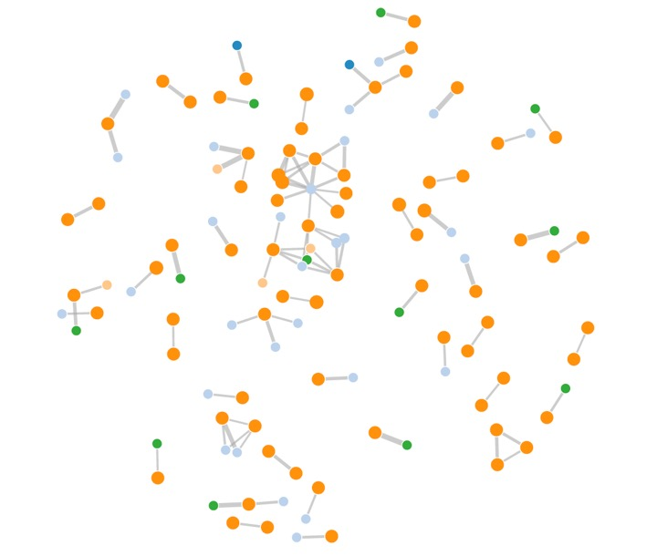
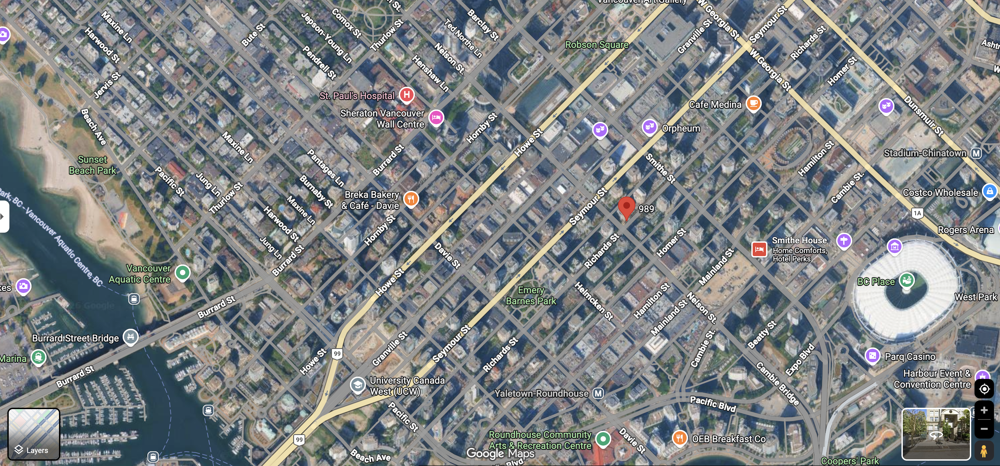
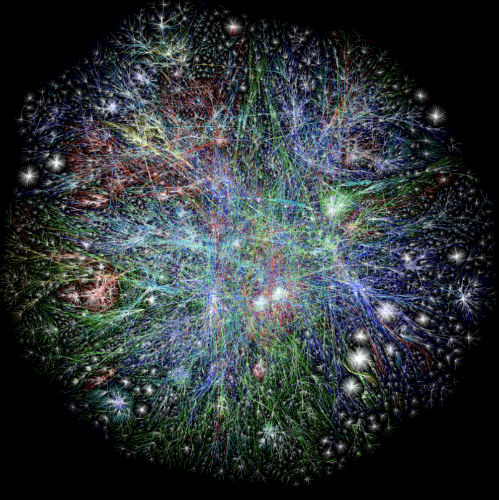
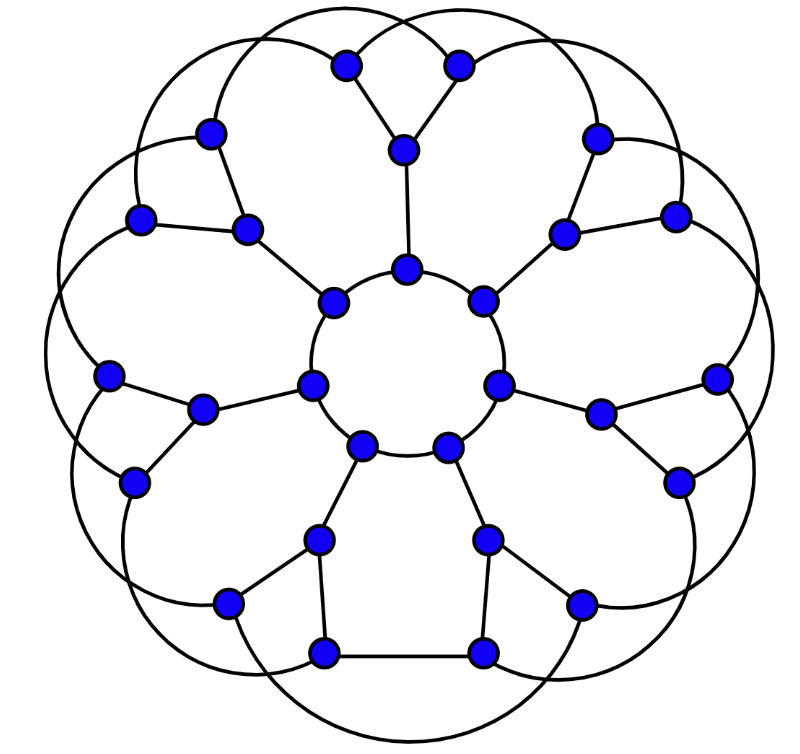
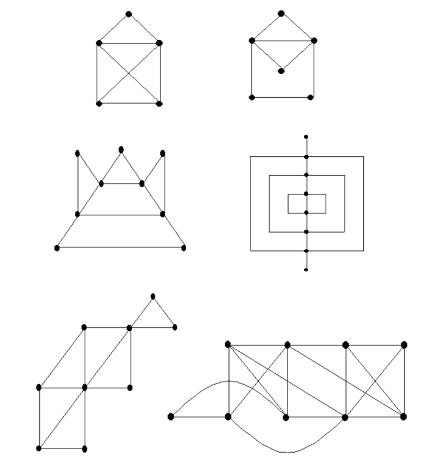
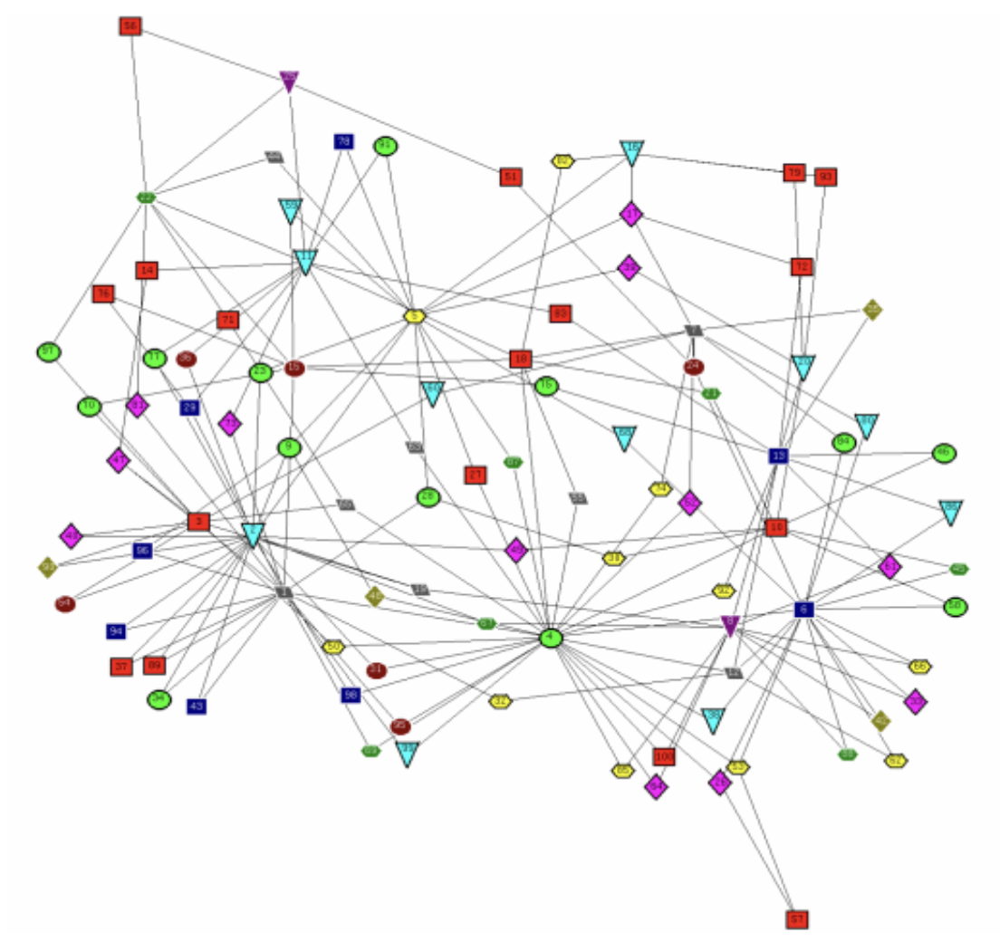
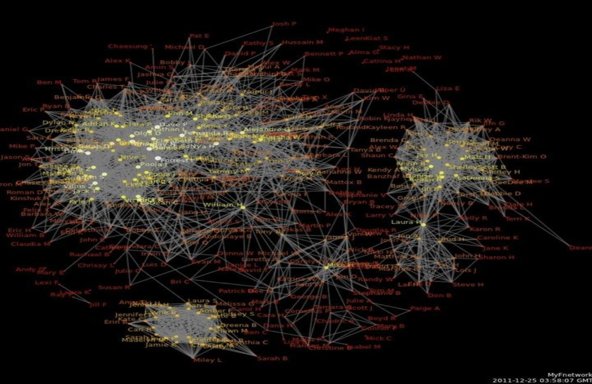
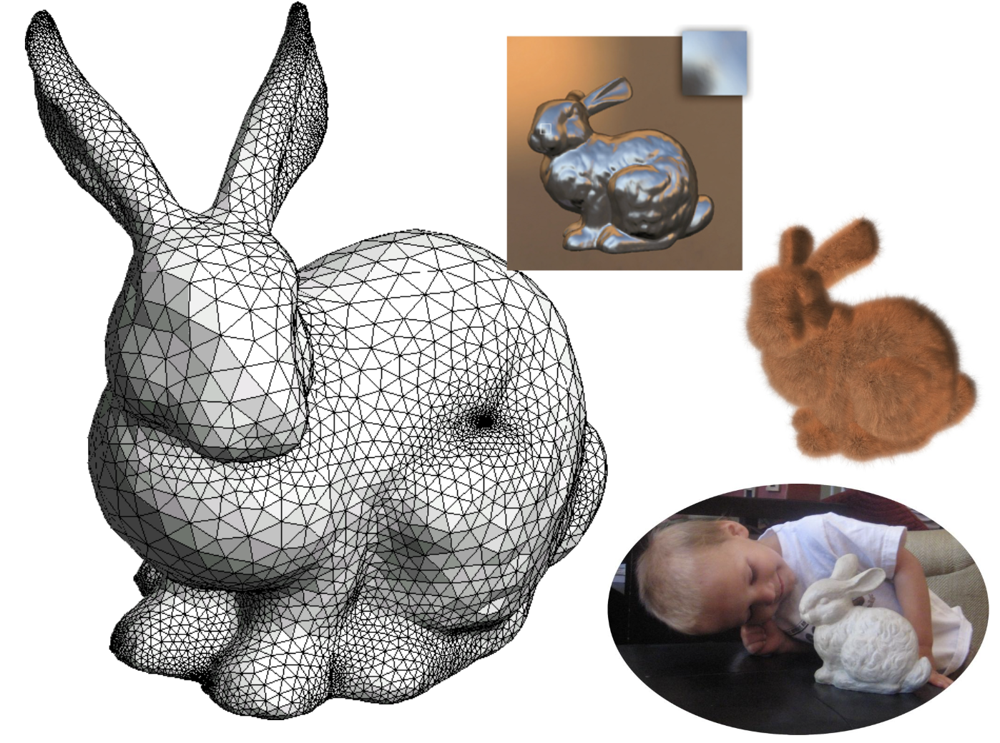
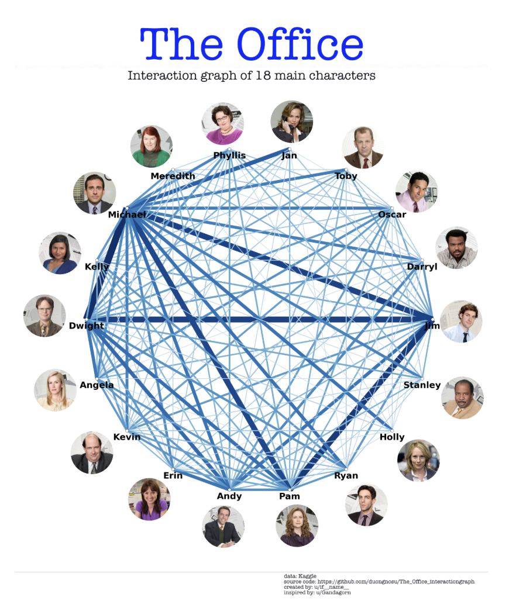

## Today {.smaller}

**Announcements**

- **Examlet 8** is Thursday to Sunday: hashing, priority queues, heaps
- **Lab Heaps** is due Sunday 11/29
- **HW3** is due Monday 12/07
- **Friday:** video lecture, disjoint sets (on PEX9 and Examlet 9)

\

**Today:** Graphs, continued

- Finish definitions
- Implementation: adjacency matrix and adjacency list

## Collaboration Graph {.smaller}

:::: {.columns}
::: {.column width="56%"}
{width="88%" fig-align="center"}
:::
::: {.column width="44%"}
**Graph (V,E):**

&nbsp;&nbsp; V: &emsp; [student PA3 submissions]{style="color:#3c78d8; font-style:italic"}

&nbsp;&nbsp; E: &emsp; [$(u,v)$ if $u$ is similar to $v$]{style="color:#3c78d8; font-style:italic"}

&nbsp;&nbsp; Aux: &emsp; [vertex labelled by term]{style="color:#3c78d8; font-style:italic"}

&nbsp;

**Sparse Graph:**

[$|E| = O(|V|)$]{style="color:#3c78d8; font-size:1.15em"}
:::
::::


## Downtown Vancouver {.smaller}

:::: {.columns}
::: {.column width="58%"}
{width="100%"}
:::
::: {.column width="42%"}
**Graph (V,E):**

&nbsp;&nbsp; V: &emsp; \_\_\_\_\_\_\_\_\_\_\_\_\_\_\_\_\_\_\_

&nbsp;&nbsp; E: &emsp; \_\_\_\_\_\_\_\_\_\_\_\_\_\_\_\_\_\_\_

&nbsp;

**Directed Graph:**\
[each edge $(u,v)$ is ordered: $(u,v) \neq (v,u)$.]{style="color:#3c78d8; font-style:italic"}\
[Howe (↓) and Seymour (↑) make this directed.]{style="color:#3c78d8; font-style:italic"}

**Weighted Graph:**\
[each edge carries a weight $w(u,v)$:]{style="color:#3c78d8; font-style:italic"}\
[here, travel time in minutes.]{style="color:#3c78d8; font-style:italic"}

**In/Out-degree(v):**\
[\# edges directed into / out of $v$.]{style="color:#3c78d8; font-style:italic"}

*Fastest route:*\
*Seymour & Georgia → Burrard & Helmcken?*
:::
::::


## Graph Vocabulary {.smaller}

:::: {.columns}
::: {.column width="42%"}

```{=html}
<div style="position:relative">
<svg viewBox="0 0 475 500" xmlns="http://www.w3.org/2000/svg" style="max-width:100%; font-family:sans-serif">
  <!-- ===== LEFT COMPONENT ===== -->
  <!-- K5 edges -->
  <g stroke="#333" stroke-width="1.3" fill="none">
    <line x1="65"  y1="65"  x2="135" y2="18"/>  <!-- a-b -->
    <line x1="65"  y1="65"  x2="205" y2="65"/>  <!-- a-c -->
    <line x1="65"  y1="65"  x2="180" y2="132"/> <!-- a-d -->
    <line x1="65"  y1="65"  x2="90"  y2="132"/> <!-- a-e -->
    <line x1="135" y1="18"  x2="205" y2="65"/>  <!-- b-c -->
    <line x1="135" y1="18"  x2="180" y2="132"/> <!-- b-d -->
    <line x1="135" y1="18"  x2="90"  y2="132"/> <!-- b-e -->
    <line x1="205" y1="65"  x2="180" y2="132"/> <!-- c-d -->
    <line x1="205" y1="65"  x2="90"  y2="132"/> <!-- c-e -->
    <line x1="90"  y1="132" x2="180" y2="132"/> <!-- d-e -->
    <!-- below K5 -->
    <line x1="90"  y1="132" x2="60"  y2="188"/> <!-- e-g -->
    <line x1="180" y1="132" x2="172" y2="188"/> <!-- d-f -->
    <line x1="60"  y1="188" x2="172" y2="188"/> <!-- g-f -->
    <!-- g-n, f-m -->
    <line x1="60"  y1="188" x2="78"  y2="242"/> <!-- g-n -->
    <line x1="172" y1="188" x2="158" y2="242"/> <!-- f-m -->
    <!-- m-n -->
    <line x1="78"  y1="242" x2="158" y2="242"/> <!-- m-n -->
    <!-- n-o, n-k, m-l -->
    <line x1="78"  y1="242" x2="38"  y2="292"/> <!-- n-o -->
    <line x1="78"  y1="242" x2="78"  y2="292"/> <!-- n-k -->
    <line x1="158" y1="242" x2="158" y2="292"/> <!-- m-l -->
    <!-- k-j, l-j -->
    <line x1="78"  y1="292" x2="118" y2="338"/> <!-- k-j -->
    <line x1="158" y1="292" x2="118" y2="338"/> <!-- l-j -->
    <!-- j-i -->
    <line x1="118" y1="338" x2="158" y2="382"/> <!-- j-i -->
    <!-- i-h -->
    <line x1="158" y1="382" x2="158" y2="422"/> <!-- i-h -->
    <!-- h-p, h-q -->
    <line x1="158" y1="422" x2="98"  y2="465"/> <!-- h-p -->
    <line x1="158" y1="422" x2="218" y2="465"/> <!-- h-q -->
  </g>
  <!-- K5 nodes -->
  <circle cx="135" cy="18"  r="12" fill="white" stroke="#333" stroke-width="1.5"/>
  <text x="135" y="23" text-anchor="middle" font-size="11" fill="#333">b</text>
  <circle cx="65"  cy="65"  r="12" fill="white" stroke="#333" stroke-width="1.5"/>
  <text x="65"  y="70" text-anchor="middle" font-size="11" fill="#333">a</text>
  <circle cx="205" cy="65"  r="12" fill="white" stroke="#333" stroke-width="1.5"/>
  <text x="205" y="70" text-anchor="middle" font-size="11" fill="#333">c</text>
  <circle cx="90"  cy="132" r="12" fill="white" stroke="#333" stroke-width="1.5"/>
  <text x="90"  y="137" text-anchor="middle" font-size="11" fill="#333">e</text>
  <circle cx="180" cy="132" r="12" fill="white" stroke="#333" stroke-width="1.5"/>
  <text x="180" y="137" text-anchor="middle" font-size="11" fill="#333">d</text>
  <!-- g, f -->
  <circle cx="60"  cy="188" r="12" fill="white" stroke="#333" stroke-width="1.5"/>
  <text x="60"  y="193" text-anchor="middle" font-size="11" fill="#333">g</text>
  <circle cx="172" cy="188" r="12" fill="white" stroke="#333" stroke-width="1.5"/>
  <text x="172" y="193" text-anchor="middle" font-size="11" fill="#333">f</text>
  <!-- n, m -->
  <circle cx="78"  cy="242" r="12" fill="white" stroke="#333" stroke-width="1.5"/>
  <text x="78"  y="247" text-anchor="middle" font-size="11" fill="#333">n</text>
  <circle cx="158" cy="242" r="12" fill="white" stroke="#333" stroke-width="1.5"/>
  <text x="158" y="247" text-anchor="middle" font-size="11" fill="#333">m</text>
  <!-- o, k, l -->
  <circle cx="38"  cy="292" r="12" fill="white" stroke="#333" stroke-width="1.5"/>
  <text x="38"  y="297" text-anchor="middle" font-size="11" fill="#333">o</text>
  <circle cx="78"  cy="292" r="12" fill="white" stroke="#333" stroke-width="1.5"/>
  <text x="78"  y="297" text-anchor="middle" font-size="11" fill="#333">k</text>
  <circle cx="158" cy="292" r="12" fill="white" stroke="#333" stroke-width="1.5"/>
  <text x="158" y="297" text-anchor="middle" font-size="11" fill="#333">l</text>
  <!-- j -->
  <circle cx="118" cy="338" r="12" fill="white" stroke="#333" stroke-width="1.5"/>
  <text x="118" y="343" text-anchor="middle" font-size="11" fill="#333">j</text>
  <!-- i -->
  <circle cx="158" cy="382" r="12" fill="white" stroke="#333" stroke-width="1.5"/>
  <text x="158" y="387" text-anchor="middle" font-size="11" fill="#333">i</text>
  <!-- h -->
  <circle cx="158" cy="422" r="12" fill="white" stroke="#333" stroke-width="1.5"/>
  <text x="158" y="427" text-anchor="middle" font-size="11" fill="#333">h</text>
  <!-- p, q -->
  <circle cx="98"  cy="465" r="12" fill="white" stroke="#333" stroke-width="1.5"/>
  <text x="98"  y="470" text-anchor="middle" font-size="11" fill="#333">p</text>
  <circle cx="218" cy="465" r="12" fill="white" stroke="#333" stroke-width="1.5"/>
  <text x="218" y="470" text-anchor="middle" font-size="11" fill="#333">q</text>

  <!-- ===== RIGHT COMPONENT: 2x5 grid ===== -->
  <g stroke="#333" stroke-width="1.3" fill="none">
    <!-- row edges -->
    <line x1="305" y1="30"  x2="375" y2="30"/>  <!-- 8-9 -->
    <line x1="305" y1="128" x2="375" y2="128"/> <!-- 6-7 -->
    <line x1="305" y1="226" x2="375" y2="226"/> <!-- 4-5 -->
    <line x1="305" y1="324" x2="375" y2="324"/> <!-- 2-3 -->
    <line x1="305" y1="422" x2="375" y2="422"/> <!-- 0-1 -->
    <!-- left col edges -->
    <line x1="305" y1="30"  x2="305" y2="128"/> <!-- 8-6 -->
    <line x1="305" y1="128" x2="305" y2="226"/> <!-- 6-4 -->
    <line x1="305" y1="226" x2="305" y2="324"/> <!-- 4-2 -->
    <line x1="305" y1="324" x2="305" y2="422"/> <!-- 2-0 -->
    <!-- right col edges -->
    <line x1="375" y1="30"  x2="375" y2="128"/> <!-- 9-7 -->
    <line x1="375" y1="128" x2="375" y2="226"/> <!-- 7-5 -->
    <line x1="375" y1="226" x2="375" y2="324"/> <!-- 5-3 -->
    <line x1="375" y1="324" x2="375" y2="422"/> <!-- 3-1 -->
  </g>
  <circle cx="305" cy="30"  r="12" fill="white" stroke="#333" stroke-width="1.5"/>
  <text x="305" y="35" text-anchor="middle" font-size="11" fill="#333">8</text>
  <circle cx="375" cy="30"  r="12" fill="white" stroke="#333" stroke-width="1.5"/>
  <text x="375" y="35" text-anchor="middle" font-size="11" fill="#333">9</text>
  <circle cx="305" cy="128" r="12" fill="white" stroke="#333" stroke-width="1.5"/>
  <text x="305" y="133" text-anchor="middle" font-size="11" fill="#333">6</text>
  <circle cx="375" cy="128" r="12" fill="white" stroke="#333" stroke-width="1.5"/>
  <text x="375" y="133" text-anchor="middle" font-size="11" fill="#333">7</text>
  <circle cx="305" cy="226" r="12" fill="white" stroke="#333" stroke-width="1.5"/>
  <text x="305" y="231" text-anchor="middle" font-size="11" fill="#333">4</text>
  <circle cx="375" cy="226" r="12" fill="white" stroke="#333" stroke-width="1.5"/>
  <text x="375" y="231" text-anchor="middle" font-size="11" fill="#333">5</text>
  <circle cx="305" cy="324" r="12" fill="white" stroke="#333" stroke-width="1.5"/>
  <text x="305" y="329" text-anchor="middle" font-size="11" fill="#333">2</text>
  <circle cx="375" cy="324" r="12" fill="white" stroke="#333" stroke-width="1.5"/>
  <text x="375" y="329" text-anchor="middle" font-size="11" fill="#333">3</text>
  <circle cx="305" cy="422" r="12" fill="white" stroke="#333" stroke-width="1.5"/>
  <text x="305" y="427" text-anchor="middle" font-size="11" fill="#333">0</text>
  <circle cx="375" cy="422" r="12" fill="white" stroke="#333" stroke-width="1.5"/>
  <text x="375" y="427" text-anchor="middle" font-size="11" fill="#333">1</text>

  <!-- annotation -->
  <text x="415" y="18"  font-size="13" fill="#3c78d8" font-weight="bold">G = (V,E)</text>
  <text x="415" y="40"  font-size="13" fill="#3c78d8">|V| = n</text>
  <text x="415" y="60"  font-size="13" fill="#3c78d8">|E| = m</text>
</svg>
</div>
```
:::
::: {.column width="58%"}
1. List the edges incident on vertex b:
2. What is the degree of vertex h?
3. List all vertices adjacent to vertex i:
4. Describe a path from p to o:
5. Describe a path from 6 to g:
6. List the vertices in the largest complete subgraph in G:
7. Describe the largest connected subgraph in G:
8. Describe the connected components in G:
9. How many edges in a spanning forest of G?
10. How many paths from 0 to 9?
11. Can you draw G with no crossing edges?
:::
::::

## Bounds {.smaller}

:::: {.columns}
::: {.column width="54%"}
{width="100%"}

[$G = (V,E) \qquad |V| = n \qquad |E| = m$]{style="color:#3c78d8; font-style:italic"}
:::
::: {.column width="46%"}
[Running times are often reported in terms of $n$,]{style="color:#3c78d8; font-style:italic"}\
[the number of vertices, but they often depend]{style="color:#3c78d8; font-style:italic"}\
[on $m$, the number of edges.]{style="color:#3c78d8; font-style:italic"}

&nbsp;

Suppose $n = 100$ vertices...

&nbsp;

Give a lower bound on $|E|$: &emsp; \_\_\_\_\_\_

&nbsp;

Give an upper bound on $|E|$: &emsp; \_\_\_\_\_\_
:::
::::


## Handshaking {.smaller}

:::: {.columns}
::: {.column width="58%"}
{width="88%" fig-align="center"}

[$G = (V,E) \qquad |V| = n \qquad |E| = m$]{style="color:#3c78d8; font-style:italic"}
:::
::: {.column width="42%"}
There are 28 vertices,\
and every vertex has degree 3.

&nbsp;

How many edges?

&nbsp;

&nbsp;

&nbsp;

In general:
:::
::::


## Activity: Pencil Puzzles {.smaller}


::::: {.columns}
::: {.column width="62%"}
You each have a graph. Do these three things:

1. Try to trace every edge exactly once without lifting your pencil. 

2. Come up with a rule that tells you if a trace is possible.

3. Devise an algorithm that will find a trace if it exists.

:::
::: {.column width="38%"}
{width="90%"}
:::
:::::


## What's left?

:::: {.columns}
::: {.column width="46%"}
```{=html}
<div style="display:grid; grid-template-columns:1fr 1fr 1fr; gap:6px; max-width:100%">
  
  
  
  
  
  
</div>
```
:::
::: {.column width="54%"}
How do we get from here to there?\
Need:

[1. Common Vocabulary]{style="color:#3c78d8; font-style:italic; font-weight:bold"}

[2. Graph implementation]{style="color:#3c78d8; font-style:italic; font-weight:bold"}

[3. Traversal]{style="color:#3c78d8; font-style:italic; font-weight:bold"}

[4. Algorithms.]{style="color:#3c78d8; font-style:italic; font-weight:bold"}
:::
::::


## Graph ADT {.smaller}

:::: {.columns}
::: {.column width="45%"}
```{=html}
<svg viewBox="0 0 400 190" width="100%">
<g stroke="#333" stroke-width="2">
<line x1="200" y1="35" x2="60" y2="150"/>
<line x1="200" y1="35" x2="250" y2="150"/>
<line x1="60" y1="150" x2="250" y2="150"/>
<line x1="250" y1="150" x2="370" y2="150"/>
</g>
<g font-family="sans-serif" font-size="22" fill="#333" text-anchor="middle">
<text x="115" y="85">a</text><text x="240" y="85">c</text>
<text x="155" y="140">b</text><text x="310" y="140">d</text>
</g>
<g fill="#cfe8ef" stroke="#333" stroke-width="2">
<circle cx="200" cy="35" r="18"/><circle cx="60" cy="150" r="18"/>
<circle cx="250" cy="150" r="18"/><circle cx="370" cy="150" r="18"/>
</g>
<g font-family="sans-serif" font-size="22" fill="#333" text-anchor="middle">
<text x="200" y="42">u</text><text x="60" y="157">v</text>
<text x="250" y="157">w</text><text x="370" y="157">z</text>
</g>
</svg>
```

**Data:**

- Vertices
- Edges
- \+ some structure that captures connectivity
:::
::: {.column width="55%"}
**Functions** (a few of them):

`insertVertex(v)`

`removeVertex(v)`

`insertEdge(v, w)`

`removeEdge(v, w)`

`incidentEdges(v)`

`areAdjacent(v, w)`

\

[$n$ vertices, $m$ edges. Simple graphs by default.]{style="color:#3c78d8; font-style:italic"}
:::
::::


## Adjacency Matrix {.smaller}

:::: {.columns}
::: {.column width="50%"}
```{=html}
<svg viewBox="0 0 400 190" width="62%">
<g stroke="#333" stroke-width="2">
<line x1="200" y1="35" x2="60" y2="150"/>
<line x1="200" y1="35" x2="250" y2="150"/>
<line x1="60" y1="150" x2="250" y2="150"/>
<line x1="250" y1="150" x2="370" y2="150"/>
</g>
<g font-family="sans-serif" font-size="22" fill="#333" text-anchor="middle">
<text x="115" y="85">a</text><text x="240" y="85">c</text>
<text x="155" y="140">b</text><text x="310" y="140">d</text>
</g>
<g fill="#cfe8ef" stroke="#333" stroke-width="2">
<circle cx="200" cy="35" r="18"/><circle cx="60" cy="150" r="18"/>
<circle cx="250" cy="150" r="18"/><circle cx="370" cy="150" r="18"/>
</g>
<g font-family="sans-serif" font-size="22" fill="#333" text-anchor="middle">
<text x="200" y="42">u</text><text x="60" y="157">v</text>
<text x="250" y="157">w</text><text x="370" y="157">z</text>
</g>
</svg>

<table class="gmat">
<tr><th></th><th>u</th><th>v</th><th>w</th><th>z</th></tr>
<tr><th>u</th><td></td><td>a</td><td>c</td><td></td></tr>
<tr><th>v</th><td>a</td><td></td><td>b</td><td></td></tr>
<tr><th>w</th><td>c</td><td>b</td><td></td><td>d</td></tr>
<tr><th>z</th><td></td><td></td><td>d</td><td></td></tr>
</table>
<style>
.gmat { border-collapse: collapse; margin: 0.3em auto; font-size: 0.85em; }
.reveal .gmat th, .reveal .gmat td { border: 2px solid #333 !important;
  width: 1.7em; height: 1.35em; text-align: center; padding: 0; }
.reveal .gmat th { background: #cfe8ef; }
.reveal .gmat tr:first-child th:first-child { background: none;
  border: none !important; }
</style>
```
:::
::: {.column width="50%"}
[An $n \times n$ table. Cell $(v,w)$ holds the edge]{style="color:#3c78d8; font-style:italic"}\
[between $v$ and $w$, or is empty.]{style="color:#3c78d8; font-style:italic"}

&nbsp;

Space: &emsp; \_\_\_\_\_\_

`insertVertex(v)` &emsp; \_\_\_\_\_\_

`removeVertex(v)` &emsp; \_\_\_\_\_\_

`incidentEdges(v)` &emsp; \_\_\_\_\_\_

`areAdjacent(v, w)` &emsp; \_\_\_\_\_\_
:::
::::


## Adjacency List {.smaller}

:::: {.columns}
::: {.column width="50%"}
```{=html}
<svg viewBox="0 0 400 190" width="62%">
<g stroke="#333" stroke-width="2">
<line x1="200" y1="35" x2="60" y2="150"/>
<line x1="200" y1="35" x2="250" y2="150"/>
<line x1="60" y1="150" x2="250" y2="150"/>
<line x1="250" y1="150" x2="370" y2="150"/>
</g>
<g font-family="sans-serif" font-size="22" fill="#333" text-anchor="middle">
<text x="115" y="85">a</text><text x="240" y="85">c</text>
<text x="155" y="140">b</text><text x="310" y="140">d</text>
</g>
<g fill="#cfe8ef" stroke="#333" stroke-width="2">
<circle cx="200" cy="35" r="18"/><circle cx="60" cy="150" r="18"/>
<circle cx="250" cy="150" r="18"/><circle cx="370" cy="150" r="18"/>
</g>
<g font-family="sans-serif" font-size="22" fill="#333" text-anchor="middle">
<text x="200" y="42">u</text><text x="60" y="157">v</text>
<text x="250" y="157">w</text><text x="370" y="157">z</text>
</g>
</svg>

<div class="glist">
<div><span class="gv">u</span>→<span class="ge">a</span>→<span class="ge">c</span></div>
<div><span class="gv">v</span>→<span class="ge">a</span>→<span class="ge">b</span></div>
<div><span class="gv">w</span>→<span class="ge">c</span>→<span class="ge">b</span>→<span class="ge">d</span></div>
<div><span class="gv">z</span>→<span class="ge">d</span></div>
</div>
<style>
.glist { width: 14em; margin: 0.4em auto; font-size: 0.95em; }
.glist div { margin: 0.25em 0; }
.glist span { display: inline-block; width: 1.8em; text-align: center;
  border: 2px solid #333; margin: 0 0.25em; }
.gv { background: #cfe8ef; }
.ge { background: #c5e07a; }
</style>
```
:::
::: {.column width="50%"}
[Each vertex keeps a list of its incident edges.]{style="color:#3c78d8; font-style:italic"}\
[Each edge knows its two endpoints, and]{style="color:#3c78d8; font-style:italic"}\
[where it sits in both of their lists.]{style="color:#3c78d8; font-style:italic"}

&nbsp;

Space: &emsp; \_\_\_\_\_\_

`insertVertex(v)` &emsp; \_\_\_\_\_\_

`removeVertex(v)` &emsp; \_\_\_\_\_\_

`incidentEdges(v)` &emsp; \_\_\_\_\_\_

`areAdjacent(v, w)` &emsp; \_\_\_\_\_\_
:::
::::


## Running Times {.smaller}

```{=html}
<table class="gcost">
<tr><th></th><th>Adj Matrix</th><th>Adj List</th></tr>
<tr><td>Space</td><td>\(n^2\)</td><td>\(n + m\)</td></tr>
<tr><td><code>insertVertex(v)</code></td><td>\(n\)*</td><td>\(1\)</td></tr>
<tr><td><code>removeVertex(v)</code></td><td>\(n\)*</td><td>\(\deg(v)\)</td></tr>
<tr><td><code>insertEdge(v, w)</code></td><td>\(1\)</td><td>\(1\)</td></tr>
<tr><td><code>removeEdge(v, w)</code></td><td>\(1\)</td><td>\(\min(\deg(v), \deg(w))\)</td></tr>
<tr><td><code>incidentEdges(v)</code></td><td>\(n\)</td><td>\(\deg(v)\)</td></tr>
<tr><td><code>areAdjacent(v, w)</code></td><td>\(1\)</td><td>\(\min(\deg(v), \deg(w))\)</td></tr>
</table>
<style>
.reveal .gcost { border-collapse: collapse; margin: 0 auto; }
.reveal .gcost th, .reveal .gcost td { border-bottom: 1px solid #999;
  padding: 0.15em 1em; text-align: center !important; }
.reveal .gcost td:first-child { text-align: right !important; }
.reveal .gcost td:not(:first-child) { color: #3c78d8; }
</style>
```

[\* amortized: the matrix has room to grow, like a dynamic array.]{style="font-size:0.85em"}


## Which One? {.smaller}

:::: {.columns}
::: {.column width="50%"}
**Sparse graph:** $m = O(n)$

Suppose $n = 10^6$ vertices,\
each with about 10 neighbours.

&nbsp;

Matrix cells: &emsp; \_\_\_\_\_\_

List entries: &emsp; \_\_\_\_\_\_
:::
::: {.column width="50%"}
**Dense graph:** $m = \Theta(n^2)$

Space: &emsp; \_\_\_\_\_\_ &emsp; vs &emsp; \_\_\_\_\_\_

&nbsp;

[Most graphs we meet are sparse.]{style="color:#3c78d8; font-style:italic"}\
[The adjacency list is the usual choice.]{style="color:#3c78d8; font-style:italic"}
:::
::::

&nbsp;

**Next:** traversal. How long does it take to visit every vertex and edge?
